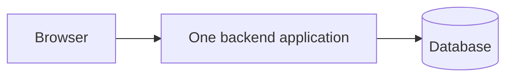
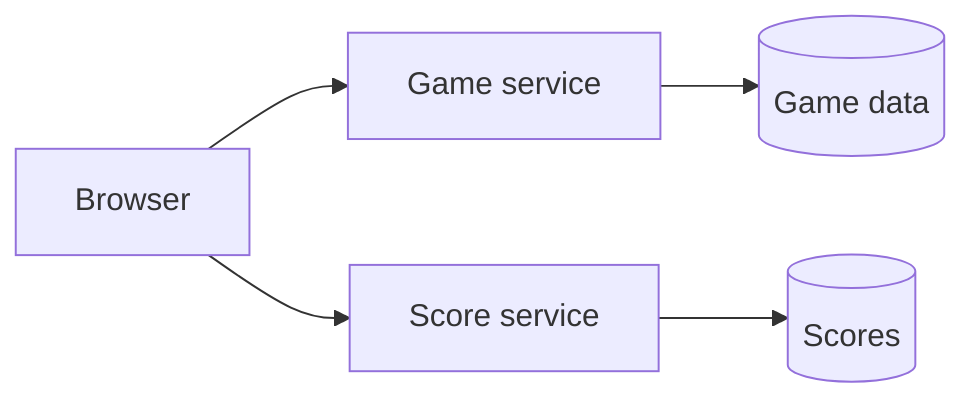
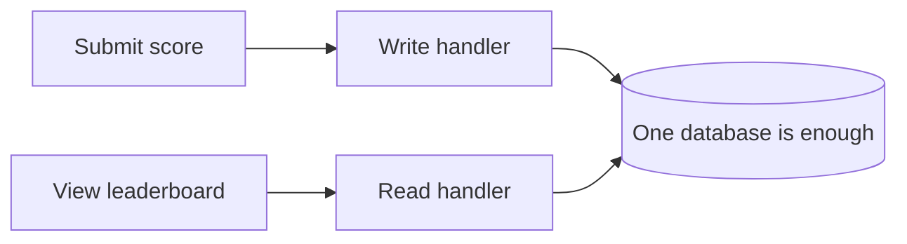

# ECM 2026: three-day backend and web course

Implemented course plan, updated 16 November 2026. The three-day materials are complete for instructor review; institutional grading and submission choices remain explicitly identified below.

## Agreed constraints

- 15 final-year engineering students, working individually on their own machines.
- Around seven hours per day, possibly less. Coding experience ranges from beginner to professional.
- Students have already spent three days on HTML, CSS, JavaScript and a React todo application consuming a supplied backend.
- Retain Flask templates as a concrete introduction to server-side rendering. SSR remains a current approach.
- Testing is a central learning objective. Keep the comparison between weak and useful tests. Retain template_rendered capture after fixtures: it verifies template/context wiring, while independent HTML assertions verify the visitor’s result.
- Teach Flask, then reimplement the todo API with FastAPI and connect the existing React frontend.
- Introduce Canvas 2D, then allow a small individual game with a backend.
- Coding agents are allowed. Assess understanding and engineering decisions, not prompting ability.
- Include a concise architecture section with diagrams and tradeoffs.
- The original slides are in [Google Slides](https://docs.google.com/presentation/d/18zrTpdve2sIDFO0LlsQsUEsND7sDr9xka69duHYLBsY/edit). The reviewed snapshot is the 66-page PDF supplied by the instructor. Use Slidev as the editable source for the updated course, following the instructor's preference.
- FastAPI is the common project backend. NestJS and SQLModel are separate optional workshops; a five-minute 3D opening follows Canvas in the main deck. Final submission deadline remains undecided.
- Language: French slides and student briefs, with technical terms and code kept in English (including headers, body, request and response). Discussion and this planning document remain in English.

## Recommendation

Keep the progression **Flask HTML and Jinja, Flask JSON API, FastAPI replacement, Canvas game, game backend**. Give each transition an observable purpose.

Keep one backend stack throughout day 2: FastAPI, Pydantic, SQLAlchemy and SQLite. Show the game and leaderboard target before the todo transfer. Keep a five-minute, two-slide 3D opening after Canvas, using the prepared game and a camera slider. SQLModel and NestJS stay in the separate optional deck. Their complete examples and checkpoints remain available.

FastAPI is a different Python framework, not a different language. NestJS introduces TypeScript and a more prescribed application structure.

## Observable outcomes

By the end, each student should be able to:

1. Trace an interaction from browser to HTTP request, backend, database and response.
2. Explain whether HTML was produced on the server or rendered in the browser.
3. Implement and test a small persistent API, including invalid input and missing resources.
4. Replace an API implementation while preserving the client-facing contract.
5. Build a small playable interaction and save meaningful data through a backend.
6. Explain a test's usefulness, a design choice, and a limitation of their own work.
7. Recognise common architecture patterns and explain one reason to choose or avoid each.

## Proposed timetable

Budget per day: 375 minutes of planned activity plus 45 minutes for short breaks and overruns, excluding lunch. Confirm how the school's seven-hour day counts breaks. If usable time is shorter, use the reductions below.

### Day 1: build and understand one Flask backend

| Minutes | Activity | Evidence of progress |
| ---: | --- | --- |
| 20 | Environment check and diagnostic; start a Python project | Python 3.12 runs; no application packages yet |
| 20 | Backend purpose, HTTP and the course checkpoints | Identify request, response, headers, body and status code |
| 40 | Install Flask, then pytest; first app, route test, route decorator | See 404 make a test fail, implement the route, reach 2 passing tests |
| 40 | Move HTML into Jinja; query string, escaping and SSR | Same tests survive the template refactor; 5 cases cover the page |
| 55 | Fixtures, application factory, parametrization, template signal and test quality | Explain each guarantee and predict which test catches a regression |
| 15 | Add a JSON response using the same Flask application | A new contract test goes red, then the complete 8-case suite passes |
| 55 | Todo JSON API, CRUD and validation in short test-first cycles | Happy path, invalid input and a missing resource are tested |
| 60 | SQLite persistence and isolated test data | Data survives restart; tests do not alter development data |
| 20 | Connect the existing React frontend | Create, list, complete and delete using the Flask backend |
| 35 | Manual serialization, then Marshmallow schemas: load, dump, hooks and the existing validation contract | All 33 tests stay green, including strict booleans and no partial mutation |
| 30 | Native Flask Blueprint: group CRUD, move routes, register once per factory | All five endpoints, SSR and CORS still work; same 33 tests |
| 30 | Flask-smorest decorators and OpenAPI | Same 33 behavior tests plus two documentation tests; try a request in Swagger UI |
| 5 | Checkpoint and assessment briefing | Explain the Flask implementation and the contract to preserve on day 2 |

The fully hands-on day 1 now totals 425 minutes before breaks. It therefore exceeds the original 375-minute activity budget by 50 minutes. For the 375-minute format, teach the native Blueprint move as a 10-minute guided checkpoint comparison (save 20), demonstrate the tested SQLite route replacements for 40 minutes (save 20), and reconnect the already-built React client in 10 minutes (save 10). Keep the complete code slides available for later replay. The introduction, template signal, serialization and OpenAPI explanations remain visible. These compression choices trade student typing time for guided reading; do not advertise the full 425-minute path as fitting 375 minutes.

The schema and Blueprint refactors reuse existing behavior; OpenAPI adds documentation. The 20-minute React block reconnects the already-built frontend; the Blueprint block mainly moves tested code. These timings are a teaching target, not a measured classroom rehearsal. If beginners need more time, use a checkpoint after discussing the displayed changes; keep the validation and registration explanations visible.

The opening receives about three hours including the environment check, discussion and synchronization pauses. It is a guided coding sequence, not a compact lecture about the finished application. Spend the protected overrun budget here if beginners need it; do not make fixtures, decorators or setup invisible to recover time.

Testing starts with a deliberately limited construction test, then moves immediately to request/response behaviour. Introduce Flask, pytest and each decorator separately. Show the failure before the implementation when adding a new behaviour; show unchanged passing tests when refactoring. Install only the package needed at the current step.

Use an in-memory store only as a brief stepping stone for CRUD. Show every SQLite addition and replacement directly in the slides, including all five routes, the CLI command, fixtures and restart test. Use the checkpoint for comparison and recovery. Keep table, row, primary key and transaction explanations even when using an ORM.

FastAPI now begins on day 2, after students have built, tested, persisted and connected their first backend with Flask.

### Day 2: one journey from interaction to persisted score

| Minutes | Activity | Evidence of progress |
| ---: | --- | --- |
| 10 | Demonstrate the game and map the day | Explain the three observable milestones |
| 105 | FastAPI discovery and todo exercise | The same React client works against the new API |
| 15 | Debrief and recover to fastapi-02-crud | 25 tests pass; connect task CRUD to score submission |
| 90 | Guided Canvas 2D, then React lifecycle | A playable interaction ends with a score |
| 5 | Same game in 3D: move the camera | Compare two views, then return to the score |
| 35 | Guided integration using game-starter | POST test fails, implementation passes, React submits and reloads |
| 100 | Individual project development | Extend one working end-to-end interaction |
| 15 | Progress review and recovery | Record the next smallest deliverable for day 3 |

Total: 375 minutes. FastAPI remains the backend through Canvas and integration. The score starter deliberately uses the same SQLAlchemy configuration as the todo checkpoint; there is no ORM switch to undo.

Assessment 1 follows the guided FastAPI introduction. No evening setup is assumed. The game target is introduced before this exercise so students know why they are learning another way to implement the familiar contract.

The optional deck, slides/options.md, contains two independent workshops: SQLModel (about 30 minutes) and NestJS (about 60 minutes). Those two workshops are outside the common 375-minute path. The five-minute 3D opening is included in that path. Open them only after the core result works or in another session; they must not consume the protected integration block.

### Day 3: architecture, completion and explanation

| Minutes | Activity | Evidence of progress |
| ---: | --- | --- |
| 50 | Architecture through the same score example | Explain ports/adapters, dependency direction, one benefit and one cost |
| 30 | Beyond CRUD: authentication, jobs/cron, webhooks, cache and MCP | Recognise a concrete need, an access boundary and a useful test |
| 145 | Individual project development and coaching | Playable game, persistent backend, useful tests |
| 30 | Final verification, README and source snapshot | A classmate can follow the startup instructions |
| 115 | Shared demonstration and discussion window | Each student shows a complete interaction and explains one test |
| 5 | Course synthesis: connect, test, explain | Relate the three-day path to the demonstrated project |

These are teacher planning blocks, not individual presentation limits. No per-person duration or numerical final-project grid is prescribed in the presentation or brief. Arrange the sequence of demonstrations to fit the group.

Days 2 and 3 provide 275 minutes of individual implementation and verification, plus 35 minutes of guided game integration. Protect this time by keeping the optional frameworks outside the common path.

If final delivery is after the course, make the day-3 walkthrough formative and announce the final delivery arrangements to the whole class. Institutional grading and submission rules must be communicated separately before assessment.

If time runs short, reduce game features and the number of architecture scenarios. Keep SSR, useful tests, persistence, integration and the student's explanation.

## Flask and testing sequence

Use the previous course's concrete progression as the foundation: create the application, install pytest, write the first request test, introduce the route decorator, then build templates and introduce fixtures when setup repeats. Preserve its coding pauses and recoverable checkpoints.

The opening greeting route isolates HTTP and rendering. The next module applies the same cycle to tasks: first JSON behaviour, then CRUD, persistence and the existing React client. Do not hide this transition behind unrelated examples.

The following opening checkpoints now exist as local Git branches, downloadable ZIPs and a portable Git bundle:

| Branch | New idea | Student check |
| --- | --- | --- |
| `flask-00-ready` | A Python project without application packages | Python 3.12 runs |
| `flask-01-flask` | Install Flask, construct the application | Server runs; /bonjour returns 404 |
| `flask-02-pytest` | Install pytest, construction assertion | 1 passed; explain the narrow guarantee |
| `flask-03-route` | Request test, @app.get and first response | 2 passed, after first observing the missing route fail |
| `flask-04-template` | Move HTML into Jinja | The same 2 tests remain green |
| `flask-05-name` | Query string, template data, escaping and SSR | 5 cases pass |
| `flask-06-fixtures` | Fixtures, then an application factory | The same 5 cases remain green |
| `flask-07-test-quality` | Parametrize, comparison test, template signal and deliberate regression | 7 cases pass after restoration; predict the two failing name cases |
| `flask-08-json` | Add a JSON representation with Flask | 8 cases pass after observing the new route fail |

See `lessons/01-flask-ssr/README.md` for exact slide numbers, files, commands, results and download links. The instructor's runnable lesson is the last checkpoint, not the student's starting point.

The bundle can be cloned without a remote repository. Students with a clean working tree can switch branches; students with unfinished work can open a checkpoint in a separate worktree or unzip it into a new folder. Never require discarding student work as the recovery path.

The later CRUD, SQLite, CORS, Marshmallow, Blueprint and FastAPI checkpoints are implemented and listed in CHECKPOINTS.md. Flask 15 and 16 preserve all 33 tests from Flask 14 unchanged.

### Weak and useful tests

Retain the old slide 30 discussion, with a controlled regression exercise:

| Weak or limited assertion | What it proves | Stronger behaviour check |
| --- | --- | --- |
| App is an instance of Flask | Construction succeeds | A requested route produces the promised response |
| Response equals another rendering of the same template | Route output is consistent with that template | Expected name and task content appear, and untrusted text is escaped |
| CRUD response is 200 | Endpoint returns that status | The requested record changes and an unrelated record stays unchanged |
| A mock was called | Interaction occurred | The API result and stored data meet the requirement |
| Coverage is 100% | All measured lines were executed | A deliberate behavioural regression makes a relevant test fail |

Do not claim these weaker tests prove nothing. Explain their narrow scope. For the template example, remove the displayed user name from the template: both route and test may render the same broken output, while a content assertion catches the regression.

Use actual HTTP or test-client requests to exercise the backend. A fake database is useful for teaching dependency substitution, but should not replace every persistence check. Test fixtures use a temporary database, with configuration injected before database initialisation. Never run `drop_all` against the development database or teach migration deletion as the repair.

Keep factories, coverage tooling and advanced mocking as optional follow-up material. They should not obscure the core test design lesson.

## The todo contract

Freeze this before updating the repositories or writing assessment tests. Confirm that the frontend used in this year's first three days matches the legacy reference client.

The inspected legacy client expects `/tasks/`, a JSON array on list, `{title}` on create, `{done}` on PATCH and deletion by ID. It uses `id`, `title` and `done`; the backend also exposes `creation_date`.

Proposed core contract:

| Request | Successful behaviour |
| --- | --- |
| `GET /tasks/` | 200, array of tasks |
| `POST /tasks/` with `{title}` | 201, created task with server-generated ID and `done: false` |
| `GET /tasks/{id}` | 200, requested task |
| `PATCH /tasks/{id}` with a nonempty subset of `title`, `done` | 200, updated task; omitted fields unchanged |
| `DELETE /tasks/{id}` | 204, empty response body |

Each task has integer `id`, nonblank `title`, boolean `done` and a documented creation timestamp. Decide and document whitespace handling and limits. Recommend allowing duplicate titles, since two tasks can have the same wording; changing the legacy uniqueness constraint requires updating schema, tests and client error copy together.

Preserve legacy `PUT /tasks/{id}` if this year's frontend uses it. Otherwise teach partial updates through PATCH and keep PUT as a brief semantics comparison. Keep trailing-slash conventions explicit so redirects do not become an unexplained integration problem.

Invalid input and missing records require documented JSON errors and appropriate 4xx statuses. For the cross-framework exercise, compare successful schemas and specified failure behaviour. Do not require identical framework-generated error envelopes unless explicitly standardised in the contract. Teach that Python type annotations alone do not validate arbitrary input; FastAPI uses the declared models at the request boundary. Some conversions are allowed unless stricter validation is requested.

Use one configurable frontend API base URL, explicit development CORS origins and two separate development databases. The final comparison is a frontend configuration change, not a rewrite of frontend components.

## New slide sections

Retain the current visual identity and French teaching voice. Long examples belong in repositories. On a slide, show the relevant change, the reason and the expected observation. Keep code large enough to read from the back of the room.

### Slidev authoring workflow

Keep the presentation in this repository under `slides/`. Start with one entry deck and split the content into chapter Markdown files as it grows. Use standard layouts, a small stylesheet for the existing branding, built-in code highlighting, Mermaid diagrams and presenter notes. Custom Vue components are optional and need not introduce another framework into the students' coursework.

The browser presentation is the primary delivery format. Export a PDF handout and offline fallback; inspect the export because interactive demonstrations and reveal steps need an intentional static representation. The old Google Slides deck remains the source reference rather than a second independently maintained copy.

The first teaching deliverable is the complete guided Flask opening, with packages installed when needed and concrete recoverable checkpoints. The rebuilt opening has 48 chapter slides, preceded by the cover, instructor/student introductions and three-day learning map. File and directory creation instructions appear in the main content, with separate red, green, refactor and synchronization moments. Introduce each behavior and its purpose before proposing the helper name used to implement it. Review the slides together with their runnable states. Link larger games as standalone demos initially.

References: [Slidev guide](https://sli.dev/guide/), [syntax and presenter notes](https://sli.dev/guide/syntax), [chapter imports](https://sli.dev/features/importing-slides), [exporting](https://sli.dev/guide/exporting).

| Section | Slides delivered | Content |
| --- | ---: | --- |
| Orientation and Flask opening | 52 | Cover, instructor/student introductions, three-day map, gradual Flask/SSR/test sequence |
| Persistent todo CRUD | 57 | Contract, validation, package refactor, complete SQLite walkthrough, React |
| Flask schemas and structure | 55 | Manual serialization, load/dump diagram, hooks, native Blueprint, Flask-smorest and OpenAPI, final review |
| Day 2 orientation and FastAPI transfer | 23 | Game target, three milestones, todo contract and transition to scores |
| Canvas workshop | 24 | Drawing, time, input, collisions, state and React |
| Short 3D opening | 2 | Same paused game from two viewpoints, ready-made camera slider, return to the score |
| Game integration and project | 14 | Scope, exact folders, POST test/implementation, frontend integration and progress review |
| Architecture | 13 | Modules, layers, hexa, clean, services, events and CQRS |
| Beyond CRUD | 14 | Authentication/authorization, sessions, durable jobs and cron, webhooks, cache, MCP and scenario discussion |
| Project presentation and conclusion | 5 | Completion, reproducibility, useful tests before the presentation, then a course synthesis |
| Separate optional deck | 30 | SQLModel and NestJS with their checkpoints |

The main deck has 259 slides; the optional deck has 30. Main sequence: day 1 (1–164), day 2 (165–227), day 3 (228–259). Many slides are short coding or synchronization pauses. Separate a new requirement, failing test, implementation and recovery checkpoint when this helps students follow along.

Suggested new French slide titles include “Une requête de bout en bout”, “Le même contenu en HTML et en JSON”, “Ce que ce test garantit”, “Une base de test indépendante”, “Le même contrat avec FastAPI”, “Types et validation”, “Une image à chaque frame”, “Le serveur peut-il croire ce score ?” and “Lire et écrire avec CQRS”.

### Flask versus FastAPI

Use two comparison slides plus one small types exercise, rather than a framework catalogue.

| Topic | Flask | FastAPI |
| --- | --- | --- |
| Language | Python | Python |
| Classroom purpose | Make routing, HTML rendering and API behaviour explicit | Reuse the HTTP contract with model-based request handling |
| Validation | Explicit checks or selected extensions | Pydantic request models integrated with the framework |
| API documentation | Added through an extension in the old course | Generated OpenAPI and interactive documentation |
| Dependency lesson | pytest fixtures and configurable application setup | Request dependencies and substitution in tests |
| Tradeoff | Small core, more choices to assemble | More conventions around typed API inputs and outputs |

Mention WSGI and ASGI only after the browser/server model is understood. Avoid implying Flask cannot build APIs, that FastAPI requires every function to be async, or that changing frameworks automatically makes an application faster.

## Canvas workshop and 3D demonstration

Progress through eight visible results:

1. Black canvas and its coordinate system.
2. Player rectangle and a row of enemies.
3. Animation loop: clear, update, draw.
4. Keyboard input and movement measured using elapsed time.
5. Bullets as data moving through the scene.
6. Rectangle collisions, removal and scoring.
7. Win/lose, restart and pause.
8. React controls/HUD around the Canvas, then one save/load API interaction.

Start with JavaScript for the Canvas lesson. React can own menus and displayed scores while the game loop updates its own state. Teach cancellation and event cleanup, pause/resume timing and preventing unwanted page scrolling. Keep collision tests small and deterministic. Cover labels, visible instructions and keyboard access for the surrounding interface.

Show the prepared 3D game for five minutes, in two slides directly after Canvas. A slider moves the camera around the same game; pause to compare exactly the same state. Three.js 0.180.0 is already pinned in the supplied project. The paired front/angled screenshots provide a fallback. Keep this visual: no projection parameters, renderer implementation or new code to copy. Return explicitly to game-starter/ and the score backend.

## Final project and assessments

### Assessment 1: replace the todo backend

Deliver an individual FastAPI implementation, useful tests and a working connection to the student's existing React app. Publish requirements at the end of day 1. Provide setup and a starting test so grading does not mostly measure installation speed.

Suggested grading: 40% API behaviour and persistence, 30% useful tests, 20% frontend integration, 10% concise explanation. A strong result includes one invalid-input case and one missing-resource case, not just CRUD success responses. Ask students to identify a test that would catch a specific regression. Use automated checks and brief explanations during the lab instead of allocating a second full round of oral exams.

### Final project: one playable loop and one persisted resource

Core requirement: a small playable interaction, a frontend including React, a backend that validates and durably stores one meaningful resource, and retrieval that affects what the player sees. The resource can be scores, a saved map, inventory or saved session. Replays are a stretch option because recording inputs alone does not guarantee deterministic playback.

The game project does not need artificial update/delete endpoints if a score submission and leaderboard are its meaningful API. Full CRUD has already been assessed on the todo app.

Reference expectation: a small Space Invaders variant with start/play/end/restart, one enemy pattern, score submission and a leaderboard that survives a backend restart. Include useful tests, visible loading/error states and a README. Treat graphics, particle effects, extra levels, multiplayer and deployment as optional extensions.

The 3D demo should be clearly presented separately from the minimum reference project.

Final submission contains:

- One GitHub repository with frontend and backend and a fixed submission commit.
- Startup and test instructions that work from a fresh checkout, an environment example and no secrets.
- A short API description and a small architecture diagram.
- Tests for meaningful backend behaviour, invalid input and persistence; a game-logic test when there is nontrivial custom logic.
- A short explanation of two choices, one remaining limitation and how any generated code was checked.

The final presentation asks students to demonstrate, prove and explain: play, save and reload a result, run a meaningful test, discuss a choice and a limitation. The numerical final-project grid and individual time constraint have been removed. Institutional grading rules remain a separate instructor decision.

Coding agents are allowed. Do not grade prompt sophistication, guessed authorship or lines of code. Ask the student to explain actual code, diagnose a failed request and show how they checked a generated change. Do not require paid tooling or advantage students who can access it.

Validation does not prove that a submitted score was honestly earned. Ask students to explain this limitation. Server-authoritative gameplay and anti-cheat are discussion or extension topics, not requirements for this introductory project.

## Architecture section

Use the same game/score example on every slide. These concepts sit on different axes and can coexist: SSR describes rendering, monolith/microservices describe deployment boundaries, layers describe code organisation, and CQRS separates read and write responsibilities.

| Pattern | Plain explanation | Useful when | Cost / reason to defer |
| --- | --- | --- | --- |
| Monolith | One application deployed together | Small team, simple delivery | Parts share releases and runtime resources |
| Modular monolith | One deployment with clear internal modules | Different domains need boundaries | Boundaries need discipline |
| Layered architecture | HTTP calls business logic, which accesses data | Rules should be testable independently | Empty pass-through layers add little value |
| Hexagonal architecture | Application ports define contracts; external adapters implement them | Rules should survive a different interface or storage technology | Interfaces, assembly and integration tests remain necessary |
| Clean architecture | Source dependencies point inward toward use cases and domain rules | Domain behaviour should be independent of frameworks | Mapping and boundaries may cost more than a small CRUD needs |
| Microservices | Independently deployed services communicate | Real ownership or scaling needs differ | Network failures, contracts, deployment and data consistency |
| Event-driven processing | Publish an event for later work | Slow tasks and decoupled consumers | Retries, duplicate events and delayed results |
| CQRS | Separate how changes are handled from how data is read | Reads and writes need different models | More moving parts; a simple CRUD may not benefit |

Expand CQRS as Command Query Responsibility Segregation. Explain that it can use one database and one process. Separate read stores, eventual consistency and event sourcing are additional choices, not its definition. A NestJS module is not a microservice merely because it is a module. Saving data to an API does not imply microservices either.

Hexagonal and clean architecture are part of the core comparison. Explain dependency inversion with ScoreRepository, an SQLite adapter and an in-memory test adapter; arrows represent code dependencies, not data flow. Keep real HTTP and persistence tests. No new architecture implementation is required. Use one scenario exercise: a classroom game, a company with independently owned domains, or a leaderboard receiving many reads. Ask students to name the pressure before choosing a pattern.

## Beyond CRUD: recognise the next backend need

After the architecture comparison, spend 30 minutes on five possible extensions of the same game. These are discussion examples, not additional project requirements or new installation steps.

- Authentication establishes an identity; authorization decides whether that identity may act on a resource. An opaque server-side session illustrates how identity survives across requests.
- A durable job separates acceptance from completion. Cron is a schedule, not a synonym for asynchronous execution. Discuss timezones, retries, idempotence and job logs.
- A webhook is an HTTP callback initiated by an external service when an event happens. Verify the signature and body, acknowledge durable acceptance, and tolerate retries and duplicate event IDs.
- A cache is a temporary copy. Explain hit/miss, Time To Live, invalidation after a committed write, freshness tradeoffs and separation of private user data.
- Model Context Protocol connects an AI host/client to server capabilities. Distinguish tools, resources and prompts. A proposed read-only get_leaderboard tool reuses GET /scores/; it is not implemented or required in the provided project. Retain validation, authorization, user control and the distinction between data and instructions.

MCP references were checked against specification 2026-07-28. OWASP references support the identity/session discussion. See docs/backend-capabilities.md for the reading list and the boundaries of the examples.

The useful-test slide belongs before the individual presentation as preparation. The final slide now synthesizes the actual course: connect the interface to stored data, test observable behaviour, and explain the need and limits behind each tool. No new subject is introduced at the end.

## Proposed repository organisation

Prefer four maintained repositories over recreating every historical repository one-for-one. Names below are proposals and have not been created on GitHub.

| Proposed repository | Content | Existing material |
| --- | --- | --- |
| `ecm26` | Course index, briefs, rubric, contracts, Flask/FastAPI todo workshops and reference React client | `ecm2025`, `react-todo`, selected score examples |
| `ecm26-canvas` | Progressive JavaScript Canvas steps, React integration, short prepared 3D comparison | `space-invaders-ecm25` |
| `ecm26-game-starter` | Runnable React shell and chosen supported backend starter, with a first meaningful test | New |
| `ecm26-game-reference` | Small complete game meeting the published rubric | Simplified existing Space Invaders plus matching backend |

Keep the old repositories intact. Use numbered checkpoint branches or tags with an explicit index. Prefer stable tags for published solutions and branches only where iteration is useful. Document the distinction between student starter and teacher reference.

Do not add a shared backend abstraction merely to make Flask and FastAPI share implementation. They share a contract and acceptance behaviours. Reuse the conceptual persistence approach so the second framework does not also require learning a second ORM.

The common starter uses FastAPI and SQLAlchemy. NestJS remains a supported optional replacement after the common result works. The project expectations do not reward framework choice.

### Preparation order and completion criteria

1. **Freeze teaching decisions:** actual daily hours, final deadline, optional workshop selection, language, assessment weights and current frontend contract.
2. **Fix the reusable foundation:** test isolation, dependency versions, error handling, a clean install and exact startup commands.
3. **Build the todo progression:** SSR and test comparison, CRUD and persistence, Flask/React integration, then FastAPI compatibility checks.
4. **Build the minimum final reference:** use its actual complexity to validate the grading brief before adding optional game features.
5. **Derive the starter and Canvas steps:** ensure each checkpoint works independently and is easy to recover to.
6. **Build the course in Slidev:** preserve the previous course’s gradual introduction and recovery checkpoints. Extend the guided Flask opening into CRUD and persistence, then add the later modules. Verify the runnable checkpoints, browser presentation and PDF export together.
7. **Rehearse from fresh checkouts:** installation, migrations, tests and build; test the browser against each backend; verify saved data survives restarts and tests do not alter it.

Pin and rehearse one Python version and one Node LTS version supported by the chosen lockfiles. The materials now consistently use Python 3.12; the actual rehearsal used Python 3.12.9 and Node 26.10.0. At the review date, Node 26 and Node 24 are both listed as LTS; choose the one actually rehearsed, not an unbounded minimum.

Provide a pre-course environment checklist, known-good checkpoints, downloadable repository archives and a one-page troubleshooting guide. A browser-based fallback is useful only if it has been tested and account/network requirements are known in advance.

## Remaining decisions

1. End-of-day-3 submission or additional time afterward.
2. Allocate a separate slot only if an optional workshop is selected; do not add it silently to day 2.
3. Does this year's actual React frontend use exactly the legacy contract?
4. Confirm the school's grading rules and weighting; French materials with English technical terms are already established.

## Current implementation status

The three-day delivery is implemented: **259 main slides and 30 optional slides**, **33 checkpoint branches and ZIPs**, a portable Git bundle, two PDF handouts, runnable lessons, a game starter and reference, contracts, briefs, rubrics and environment/teacher guides. Start from README.md and CHECKPOINTS.md.

- Day1: Flask introduced progressively, SSR and the weak/useful test comparison retained, then task CRUD, a separate package refactor, SQLite, isolated tests and React integration, followed by Marshmallow schemas, Blueprint organization and Flask-smorest/OpenAPI.
- Day2: announce the game target, transfer the todo to FastAPI, create the Canvas interaction, and integrate scores using the same FastAPI/SQLAlchemy stack. A five-minute 3D opening follows Canvas; SQLModel and NestJS have a separate optional deck.
- Day3: architecture through the same game, including hexa and clean; other backend responsibilities (authentication, jobs/cron, webhooks, cache, MCP), then implementation, reproducibility, presentation and a synthesis of the three days. No numerical final-project grid or per-person time limit.
- Exact package marker placement is shown in the opening, Flask package refactor, FastAPI tree and game backend tree. No marker at the project root, in templates or in frontend folders.
- Clean checkpoint installation, intentional red transitions, regression behavior, bundle clone/worktree recovery, browser workflows and PDF rendering were checked. Detailed results are in docs/verification.md.
- The local course remains on localhost:3030. Sources and checkpoints are published at https://github.com/adrien-may/ecm2026 ; PDFs and the portable kit use the fall-2026-r2 release. Download links in both decks and PDFs point to GitHub. Offline copies remain in output/ and slides/public/checkpoints/.
- No instructor content approval was assumed. NestJS is in the separate optional support; the baseline is a submission freeze before day3 orals, with the after-course alternative documented.
- No remote repository was published. The original Google Slides and _reference/ remain unchanged. The instructor checkout retains its original uncommitted state; course checkpoint refs are separate student project snapshots.
