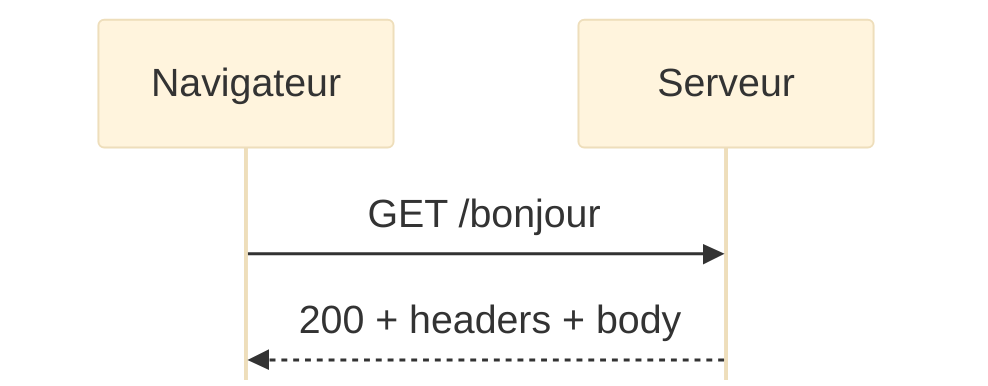
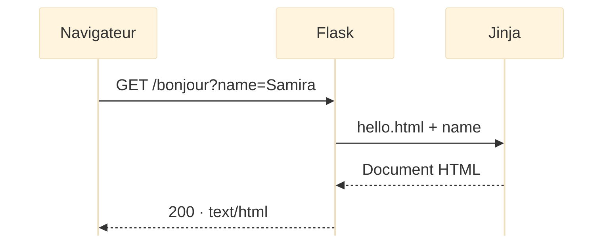

# Le serveur derrière votre frontend

<div class="lesson-step">Départ</div>

Votre application React sait afficher une liste de tâches.

Qui conserve les tâches quand on ferme le navigateur ?

Qui décide si une nouvelle tâche est valide ?

**Aujourd’hui, nous construisons cette partie serveur.**

<!--
5 min. Partir de leur application React des trois premiers jours.
Faire nommer le navigateur, l'API fournie et les données persistantes.
Le premier exercice sera une salutation pour isoler HTTP, puis le même raisonnement servira aux tâches.
-->

---

# Une request traverse une frontière

<div class="lesson-step">Départ</div>



Le navigateur envoie une demande. **Le serveur construit la response.**

<!--
5 min. Dessiner les deux machines si besoin : localhost les réunit sur le même ordinateur pendant le cours.
Pas encore de database dans cet exemple. Ne pas introduire nginx, WSGI et les contextes Flask en bloc.
-->

---

# Ce que nous allons construire

<div class="lesson-step">Départ</div>

1. Un projet Python, puis une application Flask.
2. Un test, puis une route qui lui donne raison.
3. Un template, puis un prénom fourni par la request.
4. Des fixtures, puis une régression à détecter.
5. La même salutation en JSON pour un frontend.

À chaque étape : **modifier, exécuter, comparer, reprendre si besoin**.

<!--
3 min. Expliquer que les outils arrivent quand un problème les justifie.
Les étapes vertes ont un numéro, une branche et une archive téléchargeable.
Annoncer les arrêts rouges attendus : ils font partie de l'exercice, pas d'un incident d'installation.
-->

---

# Reprendre exactement le même code

<div class="lesson-step">Repères</div>

<a href="https://github.com/adrien-may/ecm2026/raw/refs/heads/main/slides/public/checkpoints/ecm26-course.bundle" download>Télécharger toutes les branches (.bundle)</a>

```sh
git clone -b flask-00-ready \
  https://github.com/adrien-may/ecm2026.git mon-backend
cd mon-backend
```

À chaque point de synchronisation : **une branche + un ZIP complet**.

Un ZIP se décompresse dans un nouveau dossier. Votre travail reste disponible.

<!--
5 min. Le dépôt public ne demande aucun compte GitHub pour cloner. La branche main contient les supports ; flask-00-ready contient le premier projet.
Hors ligne : télécharger le bundle à l’avance, puis remplacer l’URL du clone par ecm26-course.bundle. Les mêmes branches sont disponibles.
Pour suivre depuis zéro, utiliser la diapositive suivante dans un autre dossier.
Depuis le clone, git switch flask-03-route suffit si le travail est enregistré et l'arbre propre.
Avec du travail non enregistré : git worktree add --detach ../reprise-route origin/flask-03-route.
Le guide de chaque branche détaille la reprise. Ne jamais demander git reset --hard ni git clean.
-->

---

# Nos repères dans les fichiers

**Racine du projet** : le dossier qui contient `pyproject.toml`.

- **Créer un dossier** : le faire apparaître dans l'explorateur de l'éditeur.
- **Créer un fichier** : ouvrir un nouveau fichier, puis l'enregistrer au path indiqué.
- **Modifier un fichier existant** : l'ouvrir et changer uniquement le bloc indiqué.
- **Fichier fourni** : il existe dans le ZIP extrait, on l'ouvre pour le lire ou le modifier.

`tests/conftest.py` signifie : dossier `tests/`, puis fichier **`conftest.py`**, sans « s ».

<!--
2 min. Montrer l'explorateur de l'éditeur et le terminal. Tous les paths du premier atelier partent du dossier contenant pyproject.toml, jamais du dossier des supports de cours.
-->

---

# 00 · Un projet Python, sans Flask

<div class="lesson-step">00-ready</div>

**Créer le dossier** `ecm26-flask-ssr/`, puis entrer dedans avec `cd`.

```sh
mkdir ecm26-flask-ssr
cd ecm26-flask-ssr
uv init --bare --python 3.12
uv python pin 3.12
uv run python --version
```

**Attendu : Python 3.12.x.** `pyproject.toml` décrit le projet.

`uv run` prépare son environnement dans `.venv`.

<a href="https://github.com/adrien-may/ecm2026/raw/refs/heads/main/slides/public/checkpoints/00-ready.zip" download>Reprise : 00-ready (.zip)</a>

<!--
10 min. Prérequis à installer avant le cours : Python 3.12, uv, Git et un éditeur.
Vérifier le dossier courant. Les étudiants créent un dossier de travail indépendant du dépôt des supports.
uv init --bare ne crée pas de code d'exemple ; uv python pin écrit .python-version.
uv run crée l'environnement et le lockfile au premier lancement. Aucune dépendance applicative à ce stade.
Source : https://docs.astral.sh/uv/concepts/projects/init/
-->

---

# 01 · Flask arrive maintenant

<div class="lesson-step">01-flask</div>

```sh
uv add flask==3.1.3
```

**Créer le fichier** `app.py` à la racine, à côté de `pyproject.toml`.

```python
from flask import Flask

app = Flask(__name__)
```

Flask associera des URL à nos fonctions. `app` représente l’application.

<!--
6 min. Montrer pyproject.toml et uv.lock après l'installation.
Flask apporte ses dépendances, dont Werkzeug et Jinja. Nous utiliserons Jinja plus tard sans autre installation.
__name__ indique à Flask le module de l'application, notamment pour retrouver les ressources.
Source : https://flask.palletsprojects.com/en/stable/quickstart/#a-minimal-application
-->

---

# 01 · Le serveur démarre

<div class="lesson-step">01-flask</div>

Fichiers à comparer : `app.py`.

```sh
uv run flask --app app:app run --debug --port 5001
```

**Résultat attendu : http://127.0.0.1:5001/bonjour renvoie 404.**

Branche : `flask-01-flask` · <a href="https://github.com/adrien-may/ecm2026/raw/refs/heads/main/slides/public/checkpoints/01-flask.zip" download>Code complet (.zip)</a>

Ensuite : installer pytest pour vérifier notre code.

<!--
Faire une vraie pause. Tout le monde lance la commande et compare son résultat.
Le ZIP et la branche contiennent le même état complet, avec README et uv.lock.
Les étudiants qui sont bloqués reprennent dans un nouveau dossier ; garder leur travail pour le diagnostic.
Ne pas poursuivre avant d'avoir repéré les étudiants qui n'obtiennent pas le résultat annoncé.
-->

---

# 02 · pytest arrive maintenant

<div class="lesson-step">02-pytest</div>

```sh
uv add --dev pytest==9.2.0
```

**Modifier le fichier existant** `pyproject.toml` : ajouter ce bloc à la fin.

```toml
[tool.pytest.ini_options]
testpaths = ["tests"]
```

pytest découvre les fonctions `test_*`. `assert` exprime une attente.

<!--
5 min. Distinguer Flask, dépendance de l'application, de pytest, outil de développement.
testpaths limite la recherche à nos tests. La diapositive suivante fixe la structure du package tests.
Ne pas installer coverage, pytest-flask, des factories ou des outils de mock à ce stade.
-->

---

# 02 · `__init__.py` : exactement ici

<div class="lesson-step">02-pytest</div>

**Créer le dossier** `tests/` à côté de `app.py`, puis le fichier vide **`tests/__init__.py`** dedans.

```text
ecm26-flask-ssr/
├── pyproject.toml
├── app.py
└── tests/
    ├── __init__.py    ← fichier vide
    └── test_app.py    ← à créer à la slide suivante
```

`tests/__init__.py` fait de `tests/` un package Python explicite.

**Pas à la racine. Pas dans `tests/tests/`. Pas dans `templates/`.**

<!--
5 min. Faire créer le fichier vide avec son nom exact : deux underscores, init, deux underscores, point py.
Il est au même niveau que test_app.py, directement sous tests/. Aucun contenu à y copier.
Pytest peut découvrir des tests sans __init__.py. Nous choisissons ici un package explicite pour rendre les imports prévisibles.
app.py est un module autonome : la racine du projet n'est pas un package Python à importer, donc pas de __init__.py à cet endroit.
Un futur dossier de code importable comme todo/ aura son propre todo/__init__.py ; chaque sous-package devra être marqué au niveau correspondant.
Les namespace packages sont une autre possibilité de Python, hors du périmètre de cet atelier.
-->

---

# 02 · Un premier test très limité

<div class="lesson-step">02-pytest</div>

**Créer le fichier** `tests/test_app.py`, à côté de `tests/__init__.py`.

```python
from flask import Flask
from app import app

def test_app_is_flask():
    assert isinstance(app, Flask)
```

`uv run pytest -q` : **1 passed**.

Cela vérifie la construction de l’application. **Aucune page n’est encore testée.**

<!--
6 min. Faire modifier temporairement l'assertion pour observer un échec, puis la restaurer.
Ce test reprend l'entrée du cours précédent. Sa portée est étroite, mais concrète pour l'installation et l'import.
On le garde pour comparer ce qu'il détecte avec ce que les prochains tests détectent.
Checkpoint flask-02-pytest, archive 02-pytest.zip.
-->

---

# 02 · Nous savons lancer un test

<div class="lesson-step">02-pytest</div>

Fichiers à comparer : `app.py`, `tests/test_app.py`, `pyproject.toml`.

```sh
uv run pytest -q
```

**Résultat attendu : 1 passed.**

Branche : `flask-02-pytest` · <a href="https://github.com/adrien-may/ecm2026/raw/refs/heads/main/slides/public/checkpoints/02-pytest.zip" download>Code complet (.zip)</a>

Ensuite : décrire une page avant de l’implémenter.

<!--
Faire une vraie pause. Tout le monde lance la commande et compare son résultat.
Le ZIP et la branche contiennent le même état complet, avec README et uv.lock.
Les étudiants qui sont bloqués reprennent dans un nouveau dossier ; garder leur travail pour le diagnostic.
Ne pas poursuivre avant d'avoir repéré les étudiants qui n'obtiennent pas le résultat annoncé.
-->

---

# 03 · D’abord, la page attendue

<div class="lesson-step">03-route</div>

**Modifier** `tests/test_app.py` : ajouter ce test après les tests existants.

```python
def test_default_page():
    client = app.test_client()
    response = client.get("/bonjour")
    assert response.status_code == 200
    assert "Bonjour ECM" in response.get_data(as_text=True)
```

`uv run pytest -q` : **1 passed, 1 failed**. Nous recevons encore `404`.

Le test client appelle Flask **sans lancer de serveur réseau**.

<!--
7 min. Ajouter ce test au fichier existant : ne pas remplacer le test de construction.
Lire l'échec 404 != 200 avant de montrer la solution.
response contient status code, headers et body ; get_data(as_text=True) donne le body sous forme de texte.
Source : https://flask.palletsprojects.com/en/stable/testing/
-->

---

# 03 · Le premier decorator

<div class="lesson-step">03-route</div>

**Lire cet exemple** ; la version à écrire dans `app.py` arrive ensuite.

Une fonction Python peut être passée à une autre fonction.

```python
def hello():
    return "<h1>Bonjour ECM</h1>"

hello = app.get("/bonjour")(hello)
```

`@app.get("/bonjour")` est une autre écriture de cette dernière ligne.

Ici, Flask **enregistre la fonction pour cette URL**.

<!--
7 min. Écrire l'équivalence au tableau, puis ajouter @app.get au-dessus de def sur la diapositive suivante.
Un decorator reçoit une fonction et retourne l'objet qui sera lié à son nom. Il ne crée pas forcément un wrapper.
Le decorator Flask enregistre la fonction lors du chargement du module ; la fonction de vue s'exécute lors de la request.
Ne pas conserver à la fois l'enregistrement explicite et la syntaxe @ dans app.py.
Source : https://flask.palletsprojects.com/en/stable/api/#flask.Flask.get
-->

---

# 03 · La route rend le test vert

<div class="lesson-step">03-route</div>

**Modifier** `app.py` : remplacer son contenu par cette version complète.

```python
from flask import Flask

app = Flask(__name__)

@app.get("/bonjour")
def hello():
    return "<h1>Bonjour ECM</h1>"
```

`uv run pytest -q` : **2 passed**.

Flask transforme cette chaîne en response HTTP, avec le status code `200`.

<!--
5 min. Faire le changement et lancer les tests avant de retourner au navigateur.
La route limite ici la méthode à GET (Flask fournit aussi HEAD et OPTIONS).
Il n'y a ni fixture, ni factory, ni parametrization cachée à ce stade.
-->

---

# 03 · La même response dans le navigateur

<div class="lesson-step">03-route</div>

Fichiers à comparer : `app.py`, `tests/test_app.py`.

```sh
uv run pytest -q
uv run flask --app app:app run --debug --port 5001
```

**Résultat attendu : 2 passed ; /bonjour affiche « Bonjour ECM ».**

Branche : `flask-03-route` · <a href="https://github.com/adrien-may/ecm2026/raw/refs/heads/main/slides/public/checkpoints/03-route.zip" download>Code complet (.zip)</a>

Ensuite : déplacer le HTML dans un template.

<!--
Faire une vraie pause. Tout le monde lance la commande et compare son résultat.
Le ZIP et la branche contiennent le même état complet, avec README et uv.lock.
Les étudiants qui sont bloqués reprennent dans un nouveau dossier ; garder leur travail pour le diagnostic.
Ne pas poursuivre avant d'avoir repéré les étudiants qui n'obtiennent pas le résultat annoncé.
-->

---

# 04 · Créer le dossier des templates

**Créer le dossier** `templates/` à la racine, à côté de `app.py`.

Puis **créer le fichier** `hello.html` dans ce nouveau dossier.

```text
ecm26-flask-ssr/
├── app.py
├── pyproject.toml
├── templates/          ← nouveau dossier, avec un « s »
│   └── hello.html      ← nouveau fichier, encore vide
└── tests/              ← dossier existant
```

Path final : **`templates/hello.html`**. Aucun `__init__.py` dans `templates/`.

<!--
Faire créer le dossier dans l'explorateur avant le fichier. Vérifier le niveau : pas de dossier app/, pas de templates/templates/, pas de template/ au singulier.
-->

---

# 04 · Le HTML a son propre fichier

<div class="lesson-step">04-template</div>

**Modifier** `templates/hello.html`, créé à la slide précédente : y écrire tout ce HTML.

```html
<!doctype html>
<html lang="fr">
  <head><meta charset="utf-8"><title>Bonjour</title></head>
  <body>
    <h1>Bonjour ECM</h1>
  </body>
</html>
```

Jinja est le moteur de templates fourni avec Flask.

<!--
5 min. Repartir de la route existante. Le besoin du visiteur ne change pas.
Un fichier dédié permet de faire évoluer le HTML sans le garder dans une chaîne Python.
Le checkpoint utilise la même structure HTML avec des retours à la ligne supplémentaires dans head.
-->

---

# 04 · Flask utilise le template

<div class="lesson-step">04-template</div>

**Modifier** `app.py` : compléter son import existant.

```python
from flask import Flask, render_template
```

Remplacer uniquement le body de `hello` :

```python
@app.get("/bonjour")
def hello():
    return render_template("hello.html")
```

**Les deux tests existants doivent rester verts.**

<!--
5 min. Flask cherche le fichier dans templates/. Faire provoquer puis lire TemplateNotFound si utile.
Nous changeons l'organisation du code, pas le comportement promis. Les tests de response restent inchangés.
Source : https://flask.palletsprojects.com/en/stable/quickstart/#rendering-templates
-->

---

# 04 · Même page, autre organisation

<div class="lesson-step">04-template</div>

Fichiers à comparer : `app.py`, `templates/hello.html`, `tests/test_app.py`.

```sh
uv run pytest -q
```

**Résultat attendu : 2 passed ; toujours « Bonjour ECM ».**

Branche : `flask-04-template` · <a href="https://github.com/adrien-may/ecm2026/raw/refs/heads/main/slides/public/checkpoints/04-template.zip" download>Code complet (.zip)</a>

Ensuite : personnaliser la salutation à partir de l’URL.

<!--
Faire une vraie pause. Tout le monde lance la commande et compare son résultat.
Le ZIP et la branche contiennent le même état complet, avec README et uv.lock.
Les étudiants qui sont bloqués reprennent dans un nouveau dossier ; garder leur travail pour le diagnostic.
Ne pas poursuivre avant d'avoir repéré les étudiants qui n'obtiennent pas le résultat annoncé.
-->

---

# 05 · Un nouveau besoin, un test rouge

<div class="lesson-step">05-name</div>

**Modifier** `tests/test_app.py` : ajouter ce test après les tests existants.

```python
def test_page_displays_samira():
    client = app.test_client()
    response = client.get("/bonjour?name=Samira")
    assert "Bonjour Samira" in response.get_data(as_text=True)
```

`uv run pytest -q` : **2 passed, 1 failed**.

L’URL contient un prénom. La page affiche encore « Bonjour ECM ».

<!--
6 min. Lire l'assertion échouée : nous recevons bien une response 200 mais son contenu ne répond pas au nouveau besoin.
Demander pourquoi le test de status code ne suffit pas.
-->

---

# 05 · Lire name et le transmettre

<div class="lesson-step">05-name</div>

**Modifier** `app.py` : ajouter `request` à l’import Flask et remplacer `hello()`.

```python
@app.get("/bonjour")
def hello():
    name = request.args.get("name", "ECM")
    return render_template("hello.html", name=name)
```

**Modifier** `templates/hello.html` : remplacer uniquement le `<h1>`.

```html
<h1>Bonjour {{ name }}</h1>
```

`uv run pytest -q` : **3 passed**. Sans `name`, on garde « ECM ».

<!--
7 min. Décomposer query string, request.args, valeur par défaut, argument de render_template et variable Jinja.
request décrit la request active ; ici nous le lisons à l'intérieur de la vue appelée par Flask.
Ne pas ouvrir un cours complet sur les contextes avant d'avoir ce besoin.
Source : https://flask.palletsprojects.com/en/stable/quickstart/#the-request-object
-->

---

# 05 · Le prénom peut changer

<div class="lesson-step">05-name</div>

**Modifier** `tests/test_app.py` : ajouter ce test après les tests existants.

```python
def test_page_displays_elodie():
    client = app.test_client()
    response = client.get("/bonjour?name=Élodie")
    assert "Bonjour Élodie" in response.get_data(as_text=True)
```

`uv run pytest -q` : **4 passed**.

Écrire « Samira » en dur ne suffit plus à satisfaire les deux exemples.

<!--
4 min. Conserver volontairement les deux tests presque identiques : la parametrization sera motivée par cette répétition.
Faire proposer un troisième prénom oralement, sans introduire un autre outil.
-->

---

# 05 · Le prénom reste du texte

<div class="lesson-step">05-name</div>

**Modifier** `tests/test_app.py` : ajouter ce test après les tests existants.

```python
def test_page_escapes_name():
    client = app.test_client()
    name = "<script>alert(1)</script>"
    response = client.get("/bonjour", query_string={"name": name})
    html = response.get_data(as_text=True)
    assert "&lt;script&gt;alert(1)&lt;/script&gt;" in html
    assert name not in html
```

Jinja échappe les valeurs dans un template HTML. **5 tests passent.**

<!--
6 min. query_string est une autre manière de fournir les paramètres ; le client encode les caractères pour nous.
Faire lire les entités HTML. Ne pas introduire le filtre safe comme outil ordinaire pour du texte utilisateur.
Ce cas est déjà vert grâce à Jinja : ne pas prétendre que nous avons écrit toute l'application en TDD strict.
Source : https://flask.palletsprojects.com/en/stable/templating/
-->

---

# 05 · C’est du SSR

<div class="lesson-step">05-name</div>



**SSR : Server-Side Rendering.** Le HTML contient déjà « Bonjour Samira ».

<!--
5 min. Ouvrir Réseau puis le code source de la page. Pointer le texte déjà présent dans le document reçu.
Les accolades restent dans le template du serveur, pas dans la response envoyée.
Le navigateur affiche le HTML. Le SSR reste actuel et peut coexister avec du JavaScript.
-->

---

# 05 · Une page pilotée par la request

<div class="lesson-step">05-name</div>

Fichiers à comparer : `app.py`, `templates/hello.html`, `tests/test_app.py`.

```sh
uv run pytest -q
```

**Résultat attendu : 5 passed ; ECM, Samira, Élodie et texte échappé.**

Branche : `flask-05-name` · <a href="https://github.com/adrien-may/ecm2026/raw/refs/heads/main/slides/public/checkpoints/05-name.zip" download>Code complet (.zip)</a>

Ensuite : réduire la répétition dans la préparation des tests.

<!--
Faire une vraie pause. Tout le monde lance la commande et compare son résultat.
Le ZIP et la branche contiennent le même état complet, avec README et uv.lock.
Les étudiants qui sont bloqués reprennent dans un nouveau dossier ; garder leur travail pour le diagnostic.
Ne pas poursuivre avant d'avoir repéré les étudiants qui n'obtiennent pas le résultat annoncé.
-->

---

# 06 · La préparation se répète

<div class="lesson-step">06-fixtures</div>

**Ouvrir** `tests/test_app.py` : repérer cette ligne dans les tests de page.

```python
client = app.test_client()
```

Nous voulons que pytest prépare ce client et le fournisse au test.

**Le besoin de factoriser arrive après plusieurs tests écrits à la main.**

<!--
3 min. Ouvrir le fichier complet et repérer les quatre créations de client.
Les assertions doivent rester dans les tests ; ce sont les préparatifs communs que nous allons déplacer.
-->

---

# 06 · Créer le fichier des fixtures

Le dossier `tests/` existe déjà. **Créer un seul nouveau fichier : `tests/conftest.py`.**

```text
ecm26-flask-ssr/
├── app.py
└── tests/
    ├── __init__.py     ← existant, toujours vide
    ├── test_app.py     ← nos tests existants
    └── conftest.py     ← nouveau fichier
```

Le nom exact est **`conftest.py`**, sans « s ». Le garder dans `tests/`.

pytest découvre ce fichier automatiquement. Nous allons y préparer le client.

---

# 06 · Un autre decorator : pytest.fixture

<div class="lesson-step">06-fixtures</div>

**Modifier** `tests/conftest.py`, encore vide : écrire cette première fixture.

```python
import pytest
from app import app

@pytest.fixture
def client():
    return app.test_client()
```

pytest appelle la fixture et fournit son résultat au test.

Nous allons maintenant utiliser ce client dans nos tests existants.

<!--
6 min. Étape intermédiaire avec l'application globale. Modifier les quatre tests de page : ajouter client à la signature et supprimer client = app.test_client().
Conserver les assertions et le test de construction. Les cinq tests repassent.
conftest.py est découvert par pytest ; on n'importe pas client dans le fichier de tests.
Le nom du paramètre correspond au nom de la fixture. Cette déclaration n'est pas une route Flask.
Source : https://flask.palletsprojects.com/en/stable/testing/#fixtures
-->

---

# 06 · Utiliser la fixture dans les tests

**Modifier le fichier existant** `tests/test_app.py`.

Dans chacun des quatre tests de page :

1. Ajouter `client` entre les parenthèses de la fonction.
2. Supprimer la ligne `client = app.test_client()`.
3. Garder les requests et les assertions du test.

```python
def test_default_page(client):
```

Le test `test_app_is_flask()` reste inchangé pour le moment. **5 tests passent.**

---

# 06 · Une application neuve par test

<div class="lesson-step">06-fixtures</div>

**Modifier** `app.py` : garder les imports et déplacer l’app et `hello()` dans `create_app()`.

```python
def create_app():
    app = Flask(__name__)
    @app.get("/bonjour")
    def hello():
        name = request.args.get("name", "ECM")
        return render_template("hello.html", name=name)
    return app
```

`create_app` est une fonction Python qui construit puis retourne l’application.

<!--
5 min. Faire indenter la route existante. Ne pas créer deux applications et ne pas déplacer les imports dans la fonction.
Ce changement nécessite de modifier la fixture sur la diapositive suivante : les anciens imports de app ne sont plus valides entre ces deux étapes.
La factory évitera de partager une même application mutable entre les tests. La configuration de database viendra plus tard.
Source : https://flask.palletsprojects.com/en/stable/patterns/appfactories/
-->

---

# 06 · Une fixture peut en demander une autre

<div class="lesson-step">06-fixtures</div>

**Modifier** `tests/conftest.py` : remplacer tout son contenu.

```python
import pytest
from app import create_app
@pytest.fixture
def app():
    app = create_app()
    app.config["TESTING"] = True
    return app
@pytest.fixture
def client(app):
    return app.test_client()
```

<!--
6 min. Les lignes vides sont omises sur la slide pour garder le code lisible à taille normale. Dans le fichier, séparer les fonctions par des lignes vides. Lire client → app → create_app. TESTING laisse remonter les erreurs dans les tests.
-->

---

# 06 · Adapter le premier test à la factory

**Modifier le fichier existant** `tests/test_app.py`.

1. Supprimer `from app import app`.
2. Garder `from flask import Flask`.
3. Remplacer seulement le premier test par :

```python
def test_app_is_flask(app):
    assert isinstance(app, Flask)
```

Les quatre tests de page reçoivent déjà `client`. Aucun import de `conftest.py`.

---

# 06 · Les mêmes cinq comportements

<div class="lesson-step">06-fixtures</div>

Fichiers à comparer : `app.py`, `tests/conftest.py`, `tests/test_app.py`.

```sh
uv run pytest -q
uv run flask --app app:create_app run --debug --port 5001
```

**Résultat attendu : 5 passed ; la page fonctionne toujours.**

Branche : `flask-06-fixtures` · <a href="https://github.com/adrien-may/ecm2026/raw/refs/heads/main/slides/public/checkpoints/06-fixtures.zip" download>Code complet (.zip)</a>

Ensuite : utiliser deux données pour un même test.

<!--
Faire une vraie pause. Tout le monde lance la commande et compare son résultat.
Le ZIP et la branche contiennent le même état complet, avec README et uv.lock.
Les étudiants qui sont bloqués reprennent dans un nouveau dossier ; garder leur travail pour le diagnostic.
Ne pas poursuivre avant d'avoir repéré les étudiants qui n'obtiennent pas le résultat annoncé.
-->

---

# 07 · Un test, deux exemples

<div class="lesson-step">07-test-quality</div>

**Modifier** `tests/test_app.py` : ajouter `import pytest`, remplacer les deux tests de prénom.

```python
@pytest.mark.parametrize("name", ["Samira", "Élodie"])
def test_page_displays_requested_name(client, name):
    response = client.get(
        "/bonjour", query_string={"name": name}
    )
    assert response.status_code == 200
    assert response.mimetype == "text/html"
    assert f"Bonjour {name}" in response.get_data(as_text=True)
```

Le test s’exécute deux fois. **Toujours 5 cas au total.**

<!--
6 min. Troisième decorator rencontré : app.get enregistre une route, pytest.fixture prépare une dépendance, parametrize fournit plusieurs valeurs.
name vient ici de parametrize ; client vient d'une fixture. Tous les paramètres des tests ne sont donc pas des fixtures.
Supprimer les deux anciens tests Samira/Élodie pour ne pas les compter deux fois.
-->

---

# 07 · Comparer avec le même template

<div class="lesson-step">07-test-quality</div>

**Modifier** `tests/test_app.py` : ajouter ce test, garder les autres.

```python
def test_page_matches_its_template(app, client):
    response = client.get(
        "/bonjour", query_string={"name": "Samira"}
    )
    template = app.jinja_env.get_template("hello.html")
    expected = template.render(name="Samira")
    assert response.get_data(as_text=True) == expected
```

La page et le résultat attendu utilisent **le même template**.

Quelle erreur pourrait passer inaperçue ?

<!--
5 min. Reprendre la discussion de la page 30 du cours précédent.
Le test vérifie une cohérence entre la route, les données et le template. Ne pas dire qu'il ne prouve rien.
Laisser les étudiants proposer une erreur avant de modifier le template.
-->

---

# 07 · Observer le template et son context

Le HTML reçu ne dit pas quel template l’a produit.

Le signal **`template_rendered`** annonce qu’un template vient d’être rendu.

Nous allons enregistrer **le template choisi et le context transmis** pendant le test.

`route → render_template() → signal → fonction record()`

Cette observation complète les assertions sur le contenu reçu.

<!--
Reprise de la page 36 du cours précédent. Le groupe connaît maintenant les fixtures. Un signal notifie des abonnés ; ce n’est pas une nouvelle route. Blinker est déjà une dépendance de Flask 3.1 : aucun package à installer ici.
-->

---

# 07 · Préparer la fixture de capture

**Modifier** `tests/conftest.py` : ajouter `from flask import template_rendered` aux imports, puis cette nouvelle fixture à la fin.

```python
@pytest.fixture
def captured_templates(app):
    recorded = []

    def record(sender, template, context, **extra):
        recorded.append((template, context))
```

`record()` recevra le signal. La prochaine slide complète la fixture.

<!--
record est une fonction locale, conservée pendant la fixture. sender identifie l’app ; template et context sont fournis par Flask. **extra accepte les informations supplémentaires du signal. Ne pas ajouter une seconde fixture app.
-->

---

# 07 · Écouter pendant le test seulement

**Modifier** `tests/conftest.py` : continuer **dans `captured_templates()`**, après la définition de `record()`.

```python
    template_rendered.connect(record, app)
    try:
        yield recorded
    finally:
        template_rendered.disconnect(record, app)
```

`connect()` abonne `record` à cette app. `yield` fournit la liste au test.

`finally` retire l’abonnement, **même si le test échoue**.

<!--
Reprendre le cycle fixture : préparation, exécution du test, nettoyage. L’abonnement est limité à app pour ne pas écouter les autres apps des tests. La liste se remplit pendant client.get(), avant le retour de la response.
-->

---

# 07 · Vérifier le template réellement utilisé

**Créer le fichier** `tests/test_template_signal.py`, à côté de `test_app.py`, puis écrire ce test.

```python
def test_page_uses_expected_template(client, captured_templates):
    client.get("/bonjour", query_string={"name": "Samira"})
    assert len(captured_templates) == 1
    template, context = captured_templates[0]
    assert template.name == "hello.html"
    assert context["name"] == "Samira"
```

**`uv run pytest -q` → 7 passed.** Aucun nouveau `__init__.py`.

<!--
pytest trouve la fixture dans tests/conftest.py. Ce test impose un choix interne : hello.html reçoit name. Il ne lit pas le HTML, donc il ne prouve pas encore que le prénom y apparaît.
-->

---

# 07 · Une régression volontaire

<div class="lesson-step">07-test-quality</div>

**Modifier** `templates/hello.html` : remplacer seulement le `<h1>` par :

```html
<h1>Bonjour</h1>
```

```sh
uv run pytest -q -k matches_its_template
uv run pytest -q -k uses_expected_template
uv run pytest -q -k displays_requested_name
```

**Lequel passe ? Lequel doit échouer ? Pourquoi ?**

<!--
6 min. Chacun note sa prédiction avant d'exécuter les trois commandes séparément.
Le besoin ne change pas : saluer la personne demandée. Nous avons volontairement cassé ce comportement.
Le prochain écran contient la réponse, ne pas l'afficher avant la discussion.
-->

---

# 07 · Ce que les résultats nous apprennent

<div class="lesson-step">07-test-quality</div>

| Test | Après disparition du prénom |
| --- | --- |
| Comparaison avec le template | **1 passed** |
| Signal : template et context corrects | **1 passed** |
| Prénom demandé : Samira et Élodie | **2 failed** |

Le signal prouve le template et son context. Le contenu vérifie **le besoin du visiteur**.

Dans **`templates/hello.html`**, restaurer `<h1>Bonjour {{ name }}</h1>`, puis relancer pytest.

<!--
5 min. Le premier test compare deux sorties produites par le même template devenu faux.
Le test du prénom utilise une attente indépendante de la manière dont le HTML est fabriqué.
Les tests ne disent rien ici sur la mise en page, la lisibilité, la performance ou toute l'accessibilité.
-->

---

# 07 · Le prénom est restauré

<div class="lesson-step">07-test-quality</div>

Fichiers à comparer : `tests/`, `templates/hello.html`.

```sh
uv run pytest -q
```

**Résultat attendu : 7 passed.**

Branche : `flask-07-test-quality` · <a href="https://github.com/adrien-may/ecm2026/raw/refs/heads/main/slides/public/checkpoints/07-test-quality.zip" download>Code complet (.zip)</a>

Ensuite : exposer la même information à une application frontend.

<!--
Faire une vraie pause. Tout le monde lance la commande et compare son résultat.
Le ZIP et la branche contiennent le même état complet, avec README et uv.lock.
Les étudiants qui sont bloqués reprennent dans un nouveau dossier ; garder leur travail pour le diagnostic.
Ne pas poursuivre avant d'avoir repéré les étudiants qui n'obtiennent pas le résultat annoncé.
-->

---

# 08 · Le frontend demande des données

<div class="lesson-step">08-json</div>

**Modifier** `tests/test_app.py` : ajouter ce test après les tests existants.

```python
def test_api_returns_json(client):
    response = client.get("/api/bonjour?name=Samira")
    assert response.status_code == 200
    assert response.mimetype == "application/json"
    assert response.json == {"message": "Bonjour Samira"}
```

`uv run pytest -q` : **7 passed, 1 failed**. La nouvelle URL renvoie `404`.

Le contrat attendu décrit un status code, un type de contenu et des données.

<!--
6 min. Faire le lien avec les appels fetch du frontend React déjà construit.
Nous gardons la route HTML ; il s'agit d'une seconde représentation, pas d'un remplacement du SSR.
-->

---

# 08 · Une deuxième route, le même Flask

<div class="lesson-step">08-json</div>

**Modifier** `app.py` : ajouter cette route dans `create_app()`, avant `return app`.

```python
@app.get("/api/bonjour")
def hello_json():
    name = request.args.get("name", "ECM")
    return {"message": f"Bonjour {name}"}
```

Flask convertit ce dictionnaire en response JSON :

```json
{"message": "Bonjour Samira"}
```

`uv run pytest -q` : **8 passed**. Aucun nouveau package à installer.

<!--
5 min. Montrer l'indentation : la nouvelle route est à l'intérieur de create_app, au même niveau que /bonjour, avant return app.
Comparer le Content-Type et le body des deux responses dans l'onglet Réseau.
Source : https://flask.palletsprojects.com/en/stable/quickstart/#apis-with-json
-->

---

# 08 · Où construit-on l’interface ?

<div class="lesson-step">08-json</div>

| URL | Response | Construction de l’interface |
| --- | --- | --- |
| `/bonjour` | HTML | Flask et Jinja côté serveur |
| `/api/bonjour` | JSON | Par exemple React côté navigateur |

Les deux routes utilisent **le même langage et le même framework**.

Le navigateur reste responsable de l’affichage final du HTML.

<!--
4 min. Le client React n'est pas livré dans ce premier atelier : les étudiants connaissent déjà ce rôle côté frontend.
Le SSR est un choix actuel ; HTML et JSON peuvent coexister dans la même application.
Demander de tracer les deux chemins avant de poursuivre.
-->

---

# 08 · Une application que nous avons construite

<div class="lesson-step">08-json</div>

Fichiers à comparer : `app.py`, `templates/hello.html`, `tests/`.

```sh
uv run pytest -q
uv run flask --app app:create_app run --debug --port 5001
```

**Résultat attendu : 8 passed ; les deux URL répondent.**

Branche : `flask-08-json` · <a href="https://github.com/adrien-may/ecm2026/raw/refs/heads/main/slides/public/checkpoints/08-json.zip" download>Code complet (.zip)</a>

Ensuite : appliquer ce cycle à une liste de tâches.

<!--
Faire une vraie pause. Tout le monde lance la commande et compare son résultat.
Le ZIP et la branche contiennent le même état complet, avec README et uv.lock.
Les étudiants qui sont bloqués reprennent dans un nouveau dossier ; garder leur travail pour le diagnostic.
Ne pas poursuivre avant d'avoir repéré les étudiants qui n'obtiennent pas le résultat annoncé.
-->

---

# La suite : nos premières tâches

<div class="lesson-step">Transition</div>

Nous savons déjà suivre une request, construire une response et tester un besoin.

Prochain comportement : **lister des tâches**, puis en créer une.

Avant chaque changement : écrire le résultat attendu, observer l’échec, implémenter.

Après le CRUD : conserver les données en SQLite, puis connecter votre React.

<!--
3 min. Faire reformuler le rôle de chaque outil et demander quel test détecterait une régression précise.
Le module suivant reste en Flask. FastAPI arrive seulement après l'expérience complète du premier backend.
Ce premier atelier ne contient pas encore de tâches persistantes.
-->
