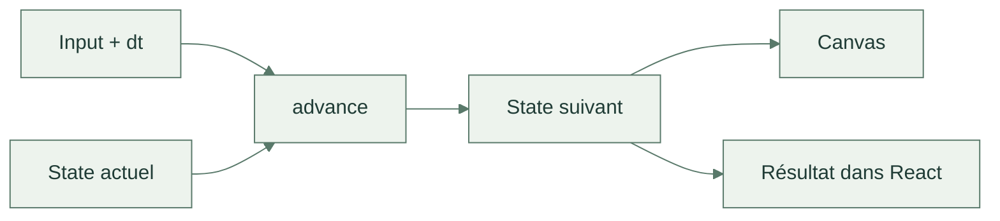

# Canvas · Une partie avant les effets

Notre objectif : bouger, tirer, toucher six cibles, finir et rejouer.

**Dessiner → animer → lire les entrées → appliquer les règles.**

Ensuite seulement : ajouter une interface React et sauvegarder un résultat.

Le jeu reste petit pour consacrer du temps au backend.

<!--
5 min. Montrer une partie de Six cibles sans parcourir toute l’implémentation. Faire nommer les états observables : playing, won, lost. Le rendu peut être simple et le produit compréhensible.
-->

---

# 01 · Préparer le dossier Canvas

**Extraire <a href="https://github.com/adrien-may/ecm2026/raw/refs/heads/main/slides/public/checkpoints/canvas-01-draw.zip" download>canvas-01-draw (.zip)</a> dans un nouveau dossier**, puis l'ouvrir dans l'éditeur.

```text
canvas-01-draw/
├── package.json        ← fourni, commandes npm
├── index.html          ← fourni, page HTML
└── src/                ← dossier fourni
    ├── main.js         ← fourni, code à modifier
    └── style.css       ← fourni, styles
```

Ouvrir le terminal dans ce dossier, là où se trouve `package.json`.

Les fichiers du premier dessin existent déjà. Nous allons les lire, puis les modifier.

---

# 01 · Un rectangle dans le navigateur

<div class="lesson-step">canvas-01-draw</div>

**Ouvrir le fichier fourni** `index.html` : repérer le Canvas.

```html
<canvas width="640" height="400" tabindex="0"></canvas>
```

**Ouvrir le fichier fourni** `src/main.js` : repérer le dessin du joueur.

```javascript
const canvas = document.querySelector('canvas');
const context = canvas.getContext('2d');
context.fillStyle = '#a8e4c4';
context.fillRect(300, 350, 40, 20);
```

`x`, `y`, largeur, hauteur : les coordonnées partent du coin supérieur gauche.

<!--
5 min. Le checkpoint fournit le fond et le CSS. Les dimensions du Canvas sont des attributs HTML, pas seulement une taille CSS. tabindex permet de donner le focus clavier. Déplacer une valeur et prédire le résultat.
-->

---

# 01 · Le premier résultat à l’écran


Un rectangle de 40 × 20 pixels, au centre en bas du Canvas.

**À vérifier : fond, couleur, position ; aucun mouvement pour l’instant.**

<!--
Capture réelle de l’étape 1 du projet workshops/canvas. Relancer npm run dev et ouvrir ?step=1 pour comparer le résultat vivant. Une capture illustre l’état attendu ; elle ne prouve pas le comportement dans le temps.
-->

---

# canvas-01-draw · Checkpoint

```sh
npm ci
npm run dev
```

**Un joueur apparaît près du bas du Canvas.**

Branche `canvas-01-draw` · <a href="https://github.com/adrien-may/ecm2026/raw/refs/heads/main/slides/public/checkpoints/canvas-01-draw.zip" download>Projet complet (.zip)</a>

Comparer les fichiers et le résultat avant de poursuivre.

<!--
Faire une pause de synchronisation. Le ZIP contient le projet entier. Extraire dans un nouveau dossier si nécessaire ; conserver le travail personnel.
-->

---

# 02 · Une image à chaque frame

**Modifier** `src/main.js` : remplacer le dessin unique par une fonction `frame()`. Extrait à compléter.

```javascript
function frame(now) {
  // 1. Mesurer le temps depuis la dernière frame.
  // 2. Mettre à jour la position.
  // 3. Effacer et redessiner.
  frameId = requestAnimationFrame(frame);
}
frameId = requestAnimationFrame(frame);
```

`requestAnimationFrame` demande un rappel avant un prochain affichage.

<!--
5 min. Éviter une boucle while qui bloque le navigateur. Le callback reçoit un timestamp en millisecondes. Montrer dans le code complet où previous est conservé entre deux appels.
-->

---

# 02 · Vitesse × temps

<div class="lesson-step">canvas-02-animation</div>

**Modifier** `src/main.js` : dans `frame()`, calculer `dt` puis mettre à jour `x`.

```javascript
const dt = previous === null ? 0 : (now - previous) / 1000;
previous = now;
x += 120 * dt;
```

120 pixels par seconde, pas 120 pixels par frame.

Le checkpoint limite `dt` à `0.05` seconde pour éviter un grand saut.

Que ferait `x += 5` sur deux écrans de fréquences différentes ?

<!--
6 min. Montrer l’erreur volontaire, puis revenir au calcul. Le cap ralentit le temps simulé lorsque le navigateur prend beaucoup de retard ; il ne constitue pas une horloge exacte. Une perte de focus sera mise en pause explicitement.
-->

---

# 02 · Le dessin devient une animation


Le même rectangle change de position à chaque frame.

**À vérifier : 120 pixels par seconde, puis un retour depuis le bord.**

<!--
Capture réelle de l’étape 2 du projet workshops/canvas. Relancer npm run dev et ouvrir ?step=2 pour comparer le résultat vivant. Une capture illustre l’état attendu ; elle ne prouve pas le comportement dans le temps.
-->

---

# canvas-02-animation · Checkpoint

```sh
npm run dev
```

**Le joueur avance à une vitesse régulière et repart du bord.**

Branche `canvas-02-animation` · <a href="https://github.com/adrien-may/ecm2026/raw/refs/heads/main/slides/public/checkpoints/canvas-02-animation.zip" download>Projet complet (.zip)</a>

Comparer les fichiers et le résultat avant de poursuivre.

<!--
Faire une pause de synchronisation. Le ZIP contient le projet entier. Extraire dans un nouveau dossier si nécessaire ; conserver le travail personnel.
-->

---

# 03 · Le clavier décrit une intention

**Modifier** `src/main.js` : ajouter les listeners après la déclaration de `canvas`, avant `frame()`.

```javascript
const keys = new Set();
canvas.addEventListener('keydown', event => keys.add(event.key));
canvas.addEventListener('keyup', event => keys.delete(event.key));
```

La frame lit cet état pour décider du déplacement.

Le fichier complet appelle `preventDefault()` pour les controls du jeu.

Cliquer dans le Canvas avant d’utiliser les flèches.

<!--
5 min. Ne pas déplacer directement à chaque répétition de keydown : la fréquence dépend du système. Limiter preventDefault aux touches utilisées et à la zone qui a le focus. Vider les touches lors de blur pour éviter un mouvement bloqué.
-->

---

# 03 · Garder le joueur dans le terrain

<div class="lesson-step">canvas-03-input</div>

**Modifier** `src/main.js` : dans `frame()`, remplacer le déplacement automatique.

```javascript
const direction = Number(keys.has('ArrowRight'))
                - Number(keys.has('ArrowLeft'));
x = Math.max(0, Math.min(600, x + direction * 280 * dt));
```

Le Canvas fait 640 pixels et le joueur 40 : **x ≤ 600**.

Deux touches opposées donnent une direction nulle.

<!--
5 min. Faire tester les deux bords. La règle appartient à la simulation ; la couleur du joueur appartient au rendu. Enlever volontairement un clamp et observer ce que le test futur devra détecter.
-->

---

# 03 · Le joueur répond au clavier


Après maintien de la flèche droite, le joueur s’arrête au bord.

**À vérifier : cliquer dans le Canvas, bouger, relâcher ; le joueur ne sort pas.**

<!--
Capture réelle de l’étape 3 du projet workshops/canvas. Relancer npm run dev et ouvrir ?step=3 pour comparer le résultat vivant. Une capture illustre l’état attendu ; elle ne prouve pas le comportement dans le temps.
-->

---

# canvas-03-input · Checkpoint

```sh
npm run dev
```

**Les flèches déplacent le joueur sans sortir du Canvas.**

Branche `canvas-03-input` · <a href="https://github.com/adrien-may/ecm2026/raw/refs/heads/main/slides/public/checkpoints/canvas-03-input.zip" download>Projet complet (.zip)</a>

Comparer les fichiers et le résultat avant de poursuivre.

<!--
Faire une pause de synchronisation. Le ZIP contient le projet entier. Extraire dans un nouveau dossier si nécessaire ; conserver le travail personnel.
-->

---

# 04 · Séparer les règles du dessin



`advance()` ne dépend ni du DOM ni du backend.

Les règles peuvent être testées sans ouvrir le navigateur.

<!--
5 min. Ouvrir game.js. Une fonction pure reçoit son état et ne modifie pas l’ancien. Pour ce petit nombre d’objets, copier l’état simplifie la compréhension ; il ne s’agit pas d’une optimisation universelle.
-->

---

# 04 · Créer le fichier des règles

Le dossier `src/` existe déjà. **Créer le fichier `src/game.js`**, à côté de `src/main.js`.

Écrire cette fonction provisoire complète :

```javascript
export function overlaps(a, b) {
  return false;
}
```

Puis **créer le fichier `src/game.test.js`** dans le même dossier. Il est encore vide.

Nous allons tester une intersection avant d'écrire sa vraie règle.

---

# 04 · Deux rectangles se croisent-ils ?

<div class="lesson-step">canvas-04-game</div>

**Modifier** `src/game.test.js`, créé à la slide précédente :

```javascript
import test from 'node:test';
import assert from 'node:assert/strict';
import { overlaps } from './game.js';

test('une intersection est détectée', () => {
  const a = {x: 0, y: 0, w: 10, h: 10};
  const b = {x: 9, y: 0, w: 10, h: 10};
  assert.equal(overlaps(a, b), true);
});
```

Lancer **`node --test src/game.test.js`** : le test doit être rouge.

<!--
6 min. test vient de node:test, assert de node:assert/strict, overlaps de ./game.js. Lancer node --test src/game.test.js. La collision est une bonne règle à tester ; une assertion sur le nombre de lignes du fichier ne le serait pas.
-->

---

# 04 · Définir notre collision

<div class="lesson-step">canvas-04-game</div>

**Modifier** `src/game.js` : remplacer seulement la fonction `overlaps()` provisoire.

```javascript
export function overlaps(a, b) {
  return a.x < b.x + b.w && a.x + a.w > b.x &&
    a.y < b.y + b.h && a.y + a.h > b.y;
}
```

Le test passe. Ajouter le cas de deux bords qui se touchent sans se croiser.

Notre convention : **un contact de bord seul n’est pas un hit**.

<!--
5 min. Dessiner deux axes avant de lire les quatre comparaisons. Montrer qu’un test à x=10 attend false. La définition choisie doit être la même dans la règle et dans l’attente du test.
-->

---

# 04 · Ouvrir le jeu complet fourni

**Extraire <a href="https://github.com/adrien-may/ecm2026/raw/refs/heads/main/slides/public/checkpoints/canvas-04-game.zip" download>canvas-04-game (.zip)</a> dans un autre dossier** et comparer sa règle `overlaps()` à la vôtre.

Les fichiers **`src/canvas.js`** et **`src/input.test.js`** sont nouveaux et fournis dans ce checkpoint.

- `src/game.js` contient les règles et l'état du jeu.
- `src/canvas.js` contient le dessin, les listeners et la boucle d'animation.
- `src/main.js` lance le jeu avec `mountGame()`.

Nous lisons les règles complètes dans ce projet avant de les modifier. Ne pas mélanger les deux dossiers de travail.

---

# 04 · Un tir, au plus une cible

**Fichier fourni** `src/game.js` dans le checkpoint `canvas-04-game` : lire la fonction `advance()`.

À chaque update :

1. Déplacer les balles avec leur vitesse et `dt`.
2. Chercher la première cible croisée.
3. Retirer cette cible et la balle, ajouter 10 points.
4. Retirer aussi les balles sorties du terrain.

Le test place deux cibles au même endroit : une balle ne doit pas compter deux hits.

<!--
7 min. Lire la boucle complète dans advance. Le cooldown limite le nombre de tirs lorsqu’on maintient espace. Éviter de supprimer des éléments dans la liste parcourue sans comprendre les index : le code construit une nouvelle liste de balles restantes.
-->

---

# 04 · Fin et restart sont des règles

**Fichiers fournis** `src/game.js` et `src/game.test.js` : repérer `newGame()`, `advance()` et leurs tests.

| État | Condition | Suite |
| --- | --- | --- |
| `playing` | Cibles restantes et temps disponible | Mettre à jour |
| `won` | Dernière cible retirée | Ajouter le bonus une fois |
| `lost` | Temps écoulé ou cible arrivée au joueur | Arrêter les règles |

`newGame()` recrée joueur, cibles, balles, score et temps.

Un restart ne doit pas conserver une balle de la partie précédente.

<!--
5 min. Faire vérifier newGame et les tests de fin. Le bonus est ceil(remaining), attribué seulement lors de la transition vers won. Le score maximal annoncé au backend est90. Changer les règles exige de reconsidérer cette borne.
-->

---

# 04 · Le résultat du jeu complet


Cibles, projectiles, score et compte à rebours sont réunis.

**À vérifier : une collision retire une cible, puis la fin de partie permet de rejouer.**

<!--
Capture réelle de l’étape 4 du projet workshops/canvas. Relancer npm run dev et ouvrir ?step=4 pour comparer le résultat vivant. Une capture illustre l’état attendu ; elle ne prouve pas le comportement dans le temps.
-->

---

# canvas-04-game · Checkpoint

```sh
npm test
npm run dev
```

**10 tests passent ; la partie finit et Rejouer remet tout à zéro.**

Branche `canvas-04-game` · <a href="https://github.com/adrien-may/ecm2026/raw/refs/heads/main/slides/public/checkpoints/canvas-04-game.zip" download>Projet complet (.zip)</a>

Comparer les fichiers et le résultat avant de poursuivre.

<!--
Faire une pause de synchronisation. Le ZIP contient le projet entier. Extraire dans un nouveau dossier si nécessaire ; conserver le travail personnel.
-->

---

# 05 · React entoure le Canvas

<div class="lesson-step">game-starter</div>

**Extraire <a href="https://github.com/adrien-may/ecm2026/raw/refs/heads/main/slides/public/checkpoints/game-starter.zip" download>game-starter (.zip)</a> à part**, puis ouvrir le fichier fourni **`frontend/src/main.jsx`**. Extrait :

```javascript
const canvas = useRef(null);
useEffect(() => {
  const game = mountGame(canvas.current, setState);
  return () => game.destroy();
}, []);
```

Le Canvas gère les frames. React affiche controls, résultat et formulaire.

`destroy()` annule la frame et retire les listeners.

<!--
6 min. Montrer le composant du starter. React StrictMode peut monter, nettoyer puis remonter un effect en développement : une boucle oubliée se verrait en double. L’état React n’est mis à jour qu’aux changements de phase, pas à chaque frame.
-->

---

# 05 · Tester aussi le cycle de vie

Dans le navigateur :

Mettre en pause, reprendre, perdre, puis rejouer.

Changer de fenêtre : reprendre sans saut ni touche bloquée.

Démonter et remonter le jeu : une seule boucle doit rester active.

**Les tests des règles ne remplacent pas cette vérification visuelle.**

<!--
5 min. Expliquer ce que le test de simulation n’observe pas : focus, listeners, dessin, bouton inaccessible. Le code garde un cleanup explicite ; un HMR de Vite ne doit pas accumuler les boucles.
-->
