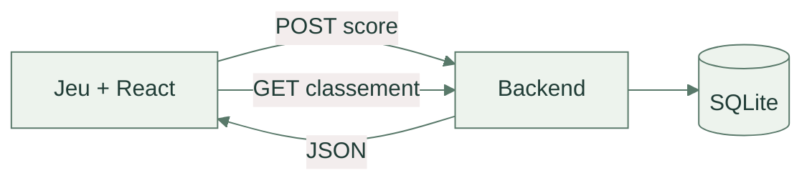

# Projet · Une mécanique, une ressource

Un jeu jouable, une fin, un restart.

Un résultat enregistré et relu depuis le backend.

Une erreur visible lorsque le backend ne répond pas.

Un test utile, une décision expliquée, une limite reconnue.

<!--
Le besoin a été annoncé au début de la journée. Le jeu fonctionne maintenant : construire ensemble son premier aller-retour backend avant le travail individuel.
-->

---

# Démontrer le trajet complet



Redémarrer le backend, puis relire le classement.

**La démonstration doit inclure le retour des données.**

<!--
5 min. Jouer la référence, sauvegarder, recharger, redémarrer et relire. Un toast « sauvegardé » seul ne prouve pas la persistance.
-->

---

# Deux points de départ explicites

| Kit | Contenu |
| --- | --- |
| `game-starter` | Jeu et GET du classement ; POST et formulaire à faire |
| `game-reference` | Parcours complet et tests, pour comprendre la cible |

<a href="https://github.com/adrien-may/ecm2026/raw/refs/heads/main/slides/public/checkpoints/game-starter.zip" download>Starter (.zip)</a> · <a href="https://github.com/adrien-may/ecm2026/raw/refs/heads/main/slides/public/checkpoints/game-reference.zip" download>Référence (.zip)</a>

**Parcours commun : FastAPI + SQLAlchemy**, comme dans le todo du matin.

<!--
5 min. Les assistants sont autorisés ; l’étudiant reste responsable des choix et tests. Le starter fonctionne déjà, mais ne prétend pas enregistrer un score. Une copie inchangée de la référence ne constitue pas une contribution personnelle.
-->

---

# Python · Le package scores

**Fichiers fournis** : les repérer dans le ZIP `game-starter`.

```text
game-starter/
├── frontend/          ← aucun marker Python
└── backend/           ← commandes Python ici
    ├── pyproject.toml
    ├── scores/
    │   └── __init__.py ← factory et routes
    └── tests/
        ├── __init__.py ← vide
        └── test_scores.py
```

Pas de marker dans `backend/`. Pas de `scores/scores/`.

<!--
3 min. Dernier rappel volontaire d’emplacement. Les fichiers de données instance/ n’ont pas de marker. Si le domaine grandit, séparer models.py et schemas.py au même niveau dans scores, sans ajouter de faux dossier.
-->

---

# Le serveur peut-il croire ce score ?

Le body contient `{"player":"Samira","points":60}`.

Valider le type, les bornes et le pseudo évite des données incohérentes.

Mais le client peut fabriquer une request sans jouer.

**Validation du format et preuve d’une partie sont deux besoins différents.**

<!--
4 min. Ne pas demander d’implémenter un anti-cheat dans ce cours. Faire proposer replay vérifiable, simulation serveur ou classement non compétitif, puis discuter des coûts. La référence annonce sa limite à l’utilisateur.
-->

---

# Projet · Lancer le backend

**Garder le dossier `game-starter/` extrait pendant le montage React.**

Terminal 1 : entrer dans **`game-starter/backend/`**, puis lancer :

```sh
uv sync --locked
uv run pytest -q
uv run uvicorn scores:create_app --factory --reload --port 8001
```

**1 test passe.** Le GET existe ; le POST reste à construire.

---

# Projet · Lancer le frontend

Terminal 2 : entrer dans **`game-starter/frontend/`**, puis lancer :

```sh
npm ci
npm test
npm run dev
```

**14 tests passent.** Ouvrir `http://localhost:5175`.

Le jeu fonctionne. Le classement est vide ; l’enregistrement reste à construire.

<!--
Le GET du classement est fourni ; un classement vide est normal. Le POST et le formulaire ne sont pas encore écrits. La factory crée les tables au lancement ; pas de commande init-db dans ce projet. Chaque terminal reste à son niveau de package manager.
-->

---

# Projet · Préparer un test isolé

**Dans `backend/tests/test_scores.py`**, ajouter `test_score_round_trip(tmp_path)` sous le test existant.

Reprendre le setup du test existant ; ses imports sont déjà présents :

```python
def test_score_round_trip(tmp_path):
    app = create_app(f"sqlite:///{tmp_path / 'test.sqlite'}")
    try:
        with TestClient(app) as client:
            pass  # Nous écrivons les assertions juste après.
    finally:
        app.state.engine.dispose()
```

Le fichier temporaire isole les données. `finally` libère la connexion.

---

# Projet · Tester l’aller-retour du score

**Dans `backend/tests/test_scores.py`**, remplacer `pass` dans le nouveau test par ces lignes, en gardant leur indentation dans `with` :

```python
data = {"player": "Samira", "points": 60}
response = client.post("/scores/", json=data)
assert response.status_code == 201
assert response.json()["player"] == "Samira"
assert response.json()["points"] == 60
rows = client.get("/scores/").json()
assert rows == [response.json()]
```

**`uv run pytest -q` → 1 passed, 1 failed : POST renvoie 405.**

<!--
Le GET existe au même path, d’où 405 et non 404. Faire dire pourquoi vérifier le POST seul ne prouve pas que le GET relira la donnée. Le test conserve une database temporaire ; ne pas raccourcir le setup au prix de l’isolation.
-->

---

# Projet · Enregistrer le score validé

**Dans `backend/scores/__init__.py`**, ajouter cette route dans `create_app()`, après `list_scores()` et avant `return app` :

```python
@app.post("/scores/", response_model=ScoreRead, status_code=201)
def save_score(data: ScoreCreate, session: DatabaseSession):
    score = Score(**data.model_dump())
    session.add(score)
    session.commit()
    session.refresh(score)
    return score
```

Les modèles et `DatabaseSession` sont **déjà fournis dans ce fichier**.

**`uv run pytest -q` → 2 passed.** Ajouter ensuite un cas invalide sans écriture.

<!--
Même trajet que POST /tasks/ : valider, construire le modèle, add, commit, refresh, response. ScoreCreate refuse notamment points < 0, points > 90 et les champs inconnus. Ne pas introduire un autre ORM pendant cette intégration.
-->

---

# Projet · Envoyer le résultat depuis React

**Modifier `frontend/src/main.jsx`**, dans le composant `App` existant :

Ajouter le state du pseudo (`player`) et celui de la sauvegarde.

Après la fin de partie, afficher un formulaire sous le résultat.

| État | Ce que voit le joueur |
| --- | --- |
| Envoi en cours | Bouton désactivé, attente visible |
| Succès | Confirmation et classement actualisé |
| Erreur | Message et possibilité de réessayer |

---

# Projet · Envoyer puis relire

**Dans `frontend/src/main.jsx`**, créer le handler submit du formulaire dans `App`, avant son `return`.

Après `event.preventDefault()`, utiliser `request` déjà fourni :

```javascript
await request('/scores/', {
  method: 'POST',
  body: JSON.stringify({player, points: state.score}),
});
await loadScores();
```

Désactiver l’envoi pendant l’attente ; afficher succès ou erreur.

<!--
Extrait à placer après preventDefault. state.score vient de mountGame. Lire frontend/src/api.js : request fournit Content-Type et lève une erreur HTTP. Le corrigé complet est dans game-reference/frontend/src/main.jsx. Faire traiter try/catch et empêcher une double sauvegarde.
-->

---

# Projet · Notre point de synchronisation

**Jouer → POST → SQLite → GET → classement.**

Redémarrer le backend : le score est toujours visible.

Arrêter le backend : l’interface affiche une erreur et permet de réessayer.

<a href="https://github.com/adrien-may/ecm2026/raw/refs/heads/main/slides/public/checkpoints/game-reference.zip" download>Référence complète (.zip)</a> : extraire à part pour comparer les fichiers.

**Référence : 11 tests backend, 14 tests frontend.** Votre suite dépend des cas ajoutés.

<!--
La référence ajoute aussi les cas de validation, le classement et la persistence ; ne pas annoncer 11 tests après le seul test round trip. Le premier trajet terminé, choisir une seule modification personnelle. Ouvrir son README pour les commandes.
-->
