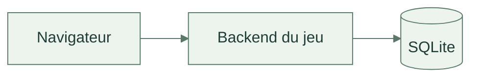
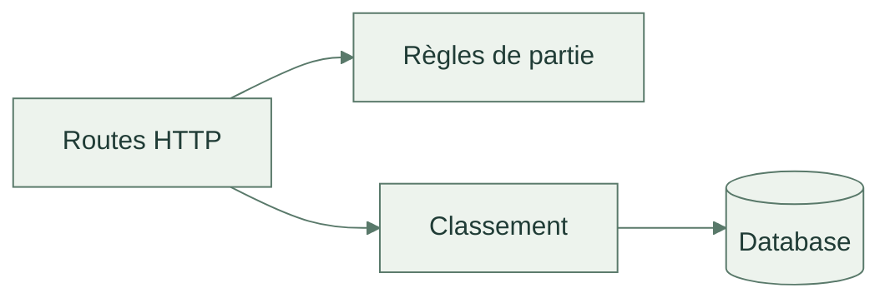
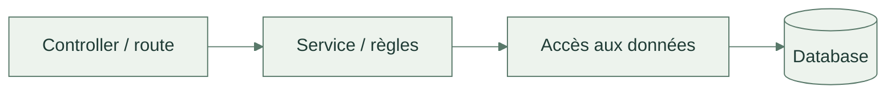
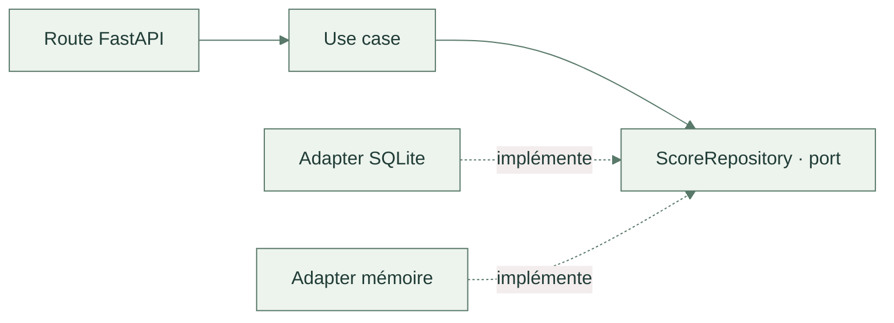
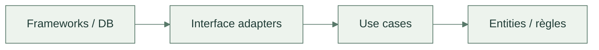
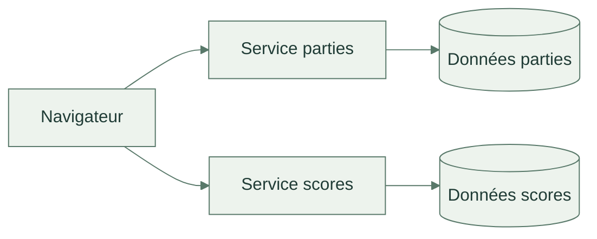
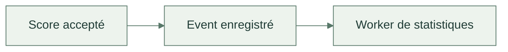
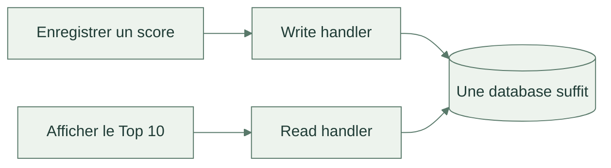

# Jour 3 · Choisir une architecture pour un besoin

Une architecture organise des responsabilités sous des contraintes.

Notre question : où placer les règles, les données et les communications ?

Partir du jeu que nous savons déjà expliquer.

Nommer la contrainte **avant** de choisir un pattern.

<!--
3 min. Ce chapitre de 50 minutes est une comparaison raisonnée, pas un catalogue à mémoriser. La petite référence sert de cas concret commun.
-->

---

# Trois décisions différentes

| Question | Exemple |
| --- | --- |
| Où produit-on l’interface ? | SSR ou rendu dans le navigateur |
| Comment organise-t-on le code ? | Modules, couches, responsabilités |
| Que déploie-t-on séparément ? | Un backend ou plusieurs services |

Un frontend React et une API ne suffisent pas à définir des microservices.

<!--
3 min. Réutiliser le SSR Flask. On peut avoir SSR et JSON dans un même déploiement ; des modules bien séparés dans un monolith ; ou plusieurs services mal structurés.
-->

---

# Monolith · Un backend à faire fonctionner

Un déploiement, un trajet simple, des transactions locales.

Limite : plusieurs besoins partagent le même rythme de livraison.

<!--
3 min. C’est un choix adapté au projet. Monolith ne signifie pas automatiquement désordre ; complexité et organisation ne se déduisent pas du nombre de processus.
-->

---

# Modular monolith · Des frontières dans le code

Les domaines sont séparés, l’application est déployée ensemble.

Coût : maintenir les frontières et éviter les imports qui les contournent.

<!--
3 min. Un module NestJS reste dans cette application. En Python, montrer où un sous-package scores/ aurait son propre __init__.py, sans confondre organisation du code et distribution réseau.
-->

---

# Layered architecture · Suivre la dépendance

Les règles importantes peuvent être testées sans le protocole HTTP.

Des couches qui ne font que transmettre des arguments ont aussi un coût.

<!--
3 min. Notre route FastAPI porte encore plusieurs responsabilités. Une fonction dédiée aux règles deviendrait utile si elles grandissaient. L’option NestJS montre une fine couche ScoresService ; elle n’est pas un prérequis. Introduire une couche parce qu’une frontière aide.
-->

---

# Hexagonal architecture · Ports and adapters

**But : protéger les règles du domaine des choix techniques.**

| Rôle | Dans notre jeu |
| --- | --- |
| Application | Enregistrer un score selon les règles |
| Port | Contrat dont l’application a besoin : stocker un score |
| Adapter | Réalisation concrète : SQLAlchemy et SQLite |

La route HTTP appelle l’application. L’application utilise un **port**, sans importer FastAPI ou SQLAlchemy.

Un port est une interface logicielle, **pas un port réseau**.

<!--
4 min. Aussi appelée hexa ou ports and adapters. On trouve des ports entrants pour les use cases et des ports sortants pour les services externes. Le nombre de côtés de l’hexagone ne représente pas six couches obligatoires. Il s’agit ici d’une évolution possible, pas d’une description de notre starter actuel.
-->

---

# Hexa · Qui dépend de qui ?

Les flèches montrent les **dépendances du code**, pas le trajet des données.

En test, l’adapter mémoire isole les règles. 
Tester aussi HTTP et SQLite : l’adapter mémoire ne les vérifie pas.

<!--
4 min. L’application définit ce qu’elle attend du stockage ; l’adapter implémente ce contrat. Au démarrage, on assemble les objets et on injecte l’adapter choisi. Le use case appelle bien cet adapter à l’exécution, mais son code dépend du port. Cela s’appelle dependency inversion.
-->

---

# Clean architecture · Dépendre vers le centre

**Les dépendances du code vont vers les règles du domaine.**

`EnregistrerScore` serait un use case ; la route et le stockage seraient à l’extérieur.

Les règles centrales ne connaissent ni HTTP, ni ORM, ni React.

<!--
4 min. Représentation linéaire des cercles habituels : les flèches vont vers le centre. Entities désigne les règles du domaine, pas automatiquement une classe ORM. Les interfaces nécessaires sont définies à l’intérieur, leurs implémentations à l’extérieur. Le flux d’exécution peut traverser la frontière dans l’autre sens grâce à cette inversion.
-->

---

# Layers, hexa, clean · Quel besoin de séparation ?

| Approche | Repère principal |
| --- | --- |
| Layered | Séparer route, règles et accès aux données |
| Hexagonal | Définir des ports et brancher des adapters |
| Clean | Orienter les dépendances vers les règles centrales |

Hexa et clean partagent une idée : **les règles ne dépendent pas du framework**.

Utile si elles grandissent ou servent plusieurs interfaces. Coût : contrats, assemblage et conversions supplémentaires.

**Notre petit CRUD peut rester simple.** Ces approches tiennent dans un monolith.

<!--
3 min. Les variantes se recouvrent ; ne pas enseigner trois recettes mutuellement exclusives ni un nombre imposé de dossiers. Demander ce qu’on gagnerait en extrayant notre unique route POST : pour le moment peu de règles, donc coût probablement supérieur au gain. Une organisation de fichiers ne prouve pas le respect des dépendances.
-->

---

# Microservices · De vrais déploiements séparés

Utile si ownership ou contraintes de déploiement diffèrent réellement.

Coût : réseau, versions de contrats, observabilité et cohérence des données.

<!--
4 min. Un appel réseau peut échouer après une action réussie. Discuter de l’incertitude et des retries avec l’enregistrement d’un score. Quinze projets étudiants n’ont pas besoin de cette séparation pour être sérieux.
-->

---

# Events · Faire un travail plus tard

Le classement peut répondre sans attendre un calcul lent.

Prévoir retries, doublons et résultat différé.

Le consommateur doit savoir traiter un event déjà reçu.

<!--
4 min. Le schéma simplifie la fiabilité de la publication : écrire la donnée et publier l’event atomiquement est un problème réel, par exemple outbox. Ne pas prétendre qu’une queue garantit exactement une exécution. Pas d’implémentation demandée dans le projet.
-->

---

# CQRS · Lire et écrire avec des modèles adaptés

**Command Query Responsibility Segregation**

**Command** change les données ; **Query** les lit. On sépare leurs responsabilités.

Event sourcing et databases séparées sont des choix supplémentaires.

<!--
4 min. CQRS peut rester dans un processus et une database. GET et POST à eux seuls ne démontrent pas une architecture CQRS utile ; la séparation prend un sens si les besoins de lecture et d’écriture divergent. Pour notre CRUD simple, elle peut coûter plus qu’elle n’apporte.
-->

---

# Exercice · Quelle contrainte justifie le coût ?

| Situation | Proposition à discuter |
| --- | --- |
| Un jeu de classe, une personne | Monolith simple |
| Plusieurs domaines, une équipe | Modules dans le même backend |
| Règles communes à une API et à un import | Ports/adapters ou clean à évaluer |
| Calcul de statistiques très lent | Traitement différé |
| Équipes et livraisons indépendantes | Services séparés à évaluer |

Choisir un cas. Expliquer **un bénéfice et un coût** avec notre trajet de score.

<!--
5 min en binômes puis deux retours. Les propositions ne sont pas des réponses automatiques : demander quelles mesures ou contraintes manquent. Pour le projet final, une solution simple justifiée vaut mieux qu’un nom de pattern sans conséquence.
-->
