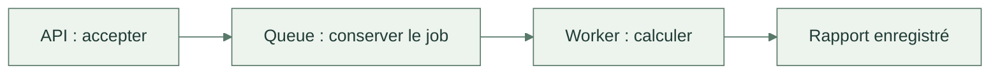
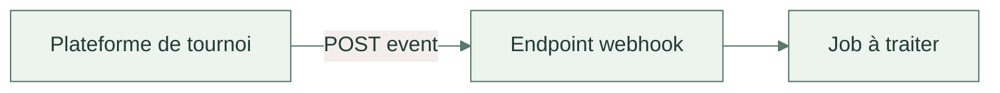
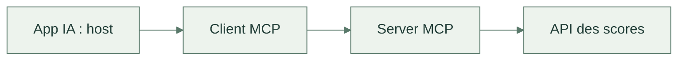

# Backend · Au-delà du CRUD

Notre jeu sait enregistrer et relire un score. De nouveaux besoins pourraient apparaître :

| Besoin | Sujet à explorer |
| --- | --- |
| Reconnaître une personne et limiter ses actions | Authentication, authorization |
| Produire un rapport ou recevoir un événement | Jobs, cron, webhooks |
| Accélérer un classement souvent consulté | Cache |
| Consulter le classement depuis un assistant | MCP |

**Découverte : aucun package à installer ni nouvelle fonctionnalité obligatoire.**

<!--
1 min. Ce chapitre de 30 minutes prolonge les choix d’architecture avec des responsabilités concrètes. Tous les exemples sont des évolutions possibles, pas des fonctions cachées du starter. Garder le projet actuel comme point de comparaison.
-->

---

# Authentication et authorization

Supposons que chaque personne puisse retirer ses propres scores.

| Question | Responsabilité |
| --- | --- |
| Qui fait la request ? | Authentication : établir une identité |
| Cette personne peut-elle retirer ce score ? | Authorization : vérifier ses droits |

Le backend vérifie les droits **sur chaque request**, même si React cache le bouton.

**Test à prévoir :** Alice est connectée, mais ne peut pas retirer le score de Bob. La donnée reste présente.

<!--
2 min. Le contrat actuel n’a pas de compte ni de DELETE scores : il s’agit d’une évolution hypothétique. Le champ player du body est une donnée déclarée, pas une identité prouvée. On retrouve souvent 401 si l’authentication manque ou n’est pas valide, 403 si l’action est interdite ; certaines API choisissent 404 pour ne pas révéler une ressource. Identifier une personne ne prouve toujours pas qu’elle a réellement joué.
Source : OWASP Authorization Cheat Sheet.
-->

---

# Session · Retrouver la personne à chaque request

**Exemple : une session conservée côté serveur.**

1. Au login, le backend vérifie les credentials et crée une session.
2. Le navigateur reçoit un cookie contenant un identifiant opaque.
3. À la request suivante, le backend retrouve la session, puis vérifie les droits.

`HttpOnly` empêche JavaScript de lire ce cookie ; `Secure` impose HTTPS.

Prévoir expiration, logout et protection contre les requests forgées (**CSRF**).

<!--
2 min. L’identifiant est aléatoire, renouvelé au login et invalidé au logout. Un password est vérifié contre un hash adapté, jamais stocké en clair. SameSite limite certains envois cross-site ; il ne remplace pas toutes les protections CSRF. CORS n’est pas une protection d’accès à l’API. Utiliser une solution de login éprouvée ; OpenID Connect permet de déléguer l’authentication à un identity provider. Un JWT est un format de token, pas une garantie générale de sécurité ni forcément un contenu chiffré. Ces alternatives ne sont pas à implémenter pendant ce survol.
Source : OWASP Session Management Cheat Sheet.
-->

---

# Jobs · Répondre avant la fin du travail

Un rapport de statistiques devient trop long pour une request HTTP.



**202 Accepted** peut confirmer la prise en charge, pas la réussite du calcul.

Le client relit ensuite un état : pending, running, done ou failed.

`async def` ne fournit pas, à lui seul, de queue durable ni de reprise après crash.

<!--
2 min. Le chemin dessiné est une architecture proposée, pas le comportement des routes actuelles. Accepter seulement après une prise en charge durable ; on peut retourner un job ID et une URL de suivi. Distinguer concurrence I/O dans une request, tâche en arrière-plan dans le même processus et worker séparé. Une queue et sa politique de persistance doivent être configurées ; le mot queue ne garantit pas la durabilité.
-->

---

# Cron · Quand déclencher un job ?

**Cron planifie un déclenchement. Le worker exécute le travail.**

Expression à lire, sans fichier à créer :

```text
minute  hour  day-of-month  month  day-of-week
0       2     *             *      *
```

Si le scheduler est configuré en **UTC** : tous les jours à **02:00 UTC**.

Le rapport quotidien est déclenché par l’horloge ; un autre job peut l’être par une request ou un event.

**Déclenché ne signifie pas terminé.** Une panne demande suivi et reprise.

<!--
2 min. Syntaxe cron classique à cinq champs ; certains schedulers ajoutent un champ secondes. Tous les moteurs ne gèrent pas de la même façon les runs manqués ou les changements d’heure. Annoncer la timezone, éviter plusieurs schedulers déclenchant le même travail et définir une règle si le run précédent n’est pas fini. Cron peut aussi lancer directement une commande : une queue n’est pas obligatoire pour un petit job local. Cron décrit le moment, pas le mécanisme de traitement.
-->

---

# Jobs · Rejouer sans doubler les effets

Le worker enregistre le rapport, puis s’arrête avant de confirmer la fin du job.

Un **retry** doit pouvoir reprendre sans créer deux rapports du même jour.

Pour ce besoin, utilisons une clé stable : `daily-report:2026-11-14`.

**Idempotence** : répéter l’opération conserve le même effet attendu.

**Test à prévoir :** exécuter deux fois pour la même date → un seul rapport.

Les logs doivent relier job ID, statut, durée et erreur éventuelle.

<!--
2 min. Le nom de clé est une proposition du cours. Une contrainte unique et une écriture transactionnelle peuvent protéger l’unicité du rapport ; un simple if avant insert ne suffit pas contre deux workers simultanés. Définir nombre de retries, délai et traitement des échecs persistants. Éviter la promesse « exactement une exécution ». Une notification externe demanderait une stratégie d’idempotence propre à ce service.
-->

---

# Webhook · Un service nous prévient

Exemple : une plateforme de tournoi signale qu’une partie est terminée.



Toujours une request HTTP : **le service l’envoie à l’événement**, sans attendre nos demandes répétées.

**Vérifier** la signature du provider et les données reçues.

**Répondre 2xx** après prise en charge durable, puis traiter le travail.

**Dédupliquer** par event ID : le provider peut envoyer plusieurs fois le même event.

<!--
2 min. Le webhook est un callback HTTP déclenché par un événement ; ce n’est pas un nouveau protocole de transport. Le diagramme est une évolution hypothétique, aucun endpoint supplémentaire n’existe dans le projet fourni. Le receiver est joignable par le provider, souvent via une URL publique HTTPS. La signature se vérifie selon la documentation du provider, généralement sur le body brut avec un secret ; prévoir les protections contre les replays. Une signature valide ne dispense pas de valider le contenu. Les retries peuvent produire des doublons et l’ordre de livraison n’est pas toujours garanti. Renvoyer rapidement un 2xx une fois l’événement accepté durablement, pas avant ; un traitement long peut ensuite être confié au worker déjà présenté. Un petit traitement peut aussi être terminé directement dans la request. Comparer au polling : notre service irait demander régulièrement si la partie est finie. Aucun développement sur RPC n’est nécessaire ici.
-->

---

# Cache · Réutiliser un résultat

Supposons que le même Top 10 soit demandé très souvent.

Un **cache** conserve une copie temporaire. La database reste la source de vérité.

| Situation | Travail du backend |
| --- | --- |
| Cache hit | Renvoyer la copie disponible |
| Cache miss | Lire la database, remplir le cache, répondre |
| TTL expiré | Considérer la copie comme absente |

**TTL = Time To Live.** Exemple à discuter : `leaderboard:global`, pendant 30 secondes.

<!--
2 min. Ce pattern est souvent appelé cache-aside. Mesurer d’abord si le calcul ou la lecture est un problème : notre petit jeu n’exige pas Redis. Un cache peut être local au processus ou partagé ; ce choix change cohérence et invalidation. Le TTL est la durée de vie choisie pour une entrée, pas une promesse de données instantanément fraîches. Ne pas confondre ici cache applicatif et cache HTTP du navigateur ou d’un CDN.
-->

---

# Cache · Après l’écriture d’un score

1. Un GET met le Top 10 dans le cache.
2. Un POST enregistre un nouveau meilleur score dans la database.
3. **Après le commit**, invalider la copie ; le prochain GET la reconstruit.

Le TTL limite la durée de vie d’une copie ; il ne garantit pas une mise à jour immédiate.

**Test à prévoir :** remplir le cache, créer le score, puis vérifier le nouveau classement.

Pour des données privées, séparer les clés par utilisateur **et vérifier les droits**. Alice ne doit jamais recevoir le cache de Bob.

<!--
2 min. Séquence simple pour discuter d’invalidation. En concurrence, un lecteur peut remettre une ancienne valeur dans le cache : cette slide n’est pas une recette complète de cohérence forte. Il faut choisir la fraîcheur acceptable et la stratégie adaptée. Les erreurs et indisponibilités du cache doivent aussi être prévues. Une clé contenant user_id ne remplace pas l’authorization ; si les droits changent, les entrées privées doivent suivre cette politique.
-->

---

# MCP · Un autre client de notre backend

**Model Context Protocol** relie une application IA à des tools et à du contexte.

« Qui est en tête du classement ? » demande de lire les données actuelles.



Le **client MCP vit dans le host**. Le server MCP expose des capacités ; notre API FastAPI peut rester en place.

<!--
3 min. Le host contient l’assistant et contrôle ses connexions ; un client MCP communique avec un server. Les cases montrent les responsabilités, pas quatre déploiements imposés. Le modèle peut proposer un tool call ; le host applique sa politique et le client échange avec le server. Un server local peut être lancé via stdio ; un server distant peut utiliser Streamable HTTP. MCP n’entraîne pas le modèle et n’est ni un modèle ni une database.
Sources vérifiées : Model Context Protocol, specification 2026-07-28, overview et transports.
-->

---

# MCP · Tools, resources, prompts

| Capacité | Rôle | Exemple pour le jeu |
| --- | --- | --- |
| Tool | Une opération invocable | Lire le classement |
| Resource | Une donnée accessible par URI | Lire les règles du jeu |
| Prompt | Une consigne réutilisable | Préparer une analyse de partie |

Le server déclare les capacités qu’il propose ; le host décide comment les utiliser.

**Un tool peut lire ou modifier des données.** Son nom ne définit pas ses permissions.

<!--
2 min. Les trois capacités ne sont pas obligatoires dans chaque server. On décrit souvent les tools comme model-controlled, les resources comme application-controlled et les prompts comme user-controlled ; le host garde le contrôle de leur exposition. Une resource n’est pas nécessairement une ligne SQL. Le prompt MCP est un modèle de consigne, sans rapport avec le template HTML Jinja du jour 1. Dans notre exemple, on proposerait seulement un tool de lecture.
-->

---

# MCP · Suivre un appel de tool

**Exemple de design, non implémenté dans le projet.**

Pour lire le classement, proposons le nom **`get_leaderboard`**.

| Étape | Observation |
| --- | --- |
| `tools/list` | Nom, description et inputSchema du tool |
| `tools/call` | `get_leaderboard`, avec arguments `{}` |
| Server MCP | Appelle `GET /scores/` et renvoie ses données |
| Host et modèle | Utilisent le résultat pour répondre |

L’assistant consulte le classement ; il ne doit pas inventer un résultat si l’API échoue.

<!--
3 min. Après découverte et sélection du tool autorisé, le client réalise l’appel. On montre les méthodes et les données utiles, pas un échange JSON-RPC complet ni un nouveau endpoint Flask/FastAPI déjà disponible. Le server MCP est un adapter à construire si l’on poursuit cette idée. Les règles d’accès et les erreurs de l’API restent nécessaires.
Source vérifiée : Model Context Protocol, specification 2026-07-28, server/tools.
-->

---

# MCP · Garder le contrôle des accès

Notre tool de lecture du classement n’accorde aucun droit de suppression.

Le **server vérifie les arguments et les droits**. Le host permet de voir les appels et de consentir aux actions.

Une valeur renvoyée par un tool reste une donnée : un pseudo contenant « ignore les règles » n’est pas une instruction.

**Tests à prévoir :** accès interdit, arguments invalides, API indisponible.

MCP relie des capacités existantes ; authentication et authorization restent à traiter.

<!--
2 min. Les descriptions et annotations d’un tool ne sont pas des garanties de sécurité. Montrer ce qui part vers quel server et encadrer les actions sensibles. Un server MCP distant protégé a besoin d’un mécanisme d’authorization adapté ; la specification s’appuie sur OAuth. Ne pas transmettre aveuglément un token destiné à un autre service. Dans notre variante read-only, un tool de suppression n’est simplement pas exposé ; les contrôles du backend ne disparaissent pas pour autant.
Sources vérifiées : MCP specification 2026-07-28, tools/security considerations et security best practices.
-->

---

# Revenir au projet · Choisir une preuve

| Évolution possible | Une preuve à demander |
| --- | --- |
| Comptes et droits | Alice ne modifie pas les données de Bob |
| Job ou webhook | Un retry ne crée pas de doublon |
| Classement en cache | Le nouveau score devient visible |
| Lecture par MCP | Un échec API n’est pas présenté comme un résultat |

Choisir un cas : **quel composant changerait, et quel test manquerait ?**

Pour la présentation, expliquer le périmètre réellement construit et ses limites.

<!--
3 min. Retour au livrable existant, pas une nouvelle liste de fonctionnalités à réaliser. On peut justifier de ne pas avoir de cache ou de jobs pour un petit jeu. L’objectif est de savoir nommer le prochain besoin et la preuve nécessaire avant de choisir un outil.
-->
