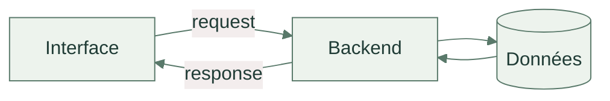

# Projet · Terminer avant d’élargir

1. Faire fonctionner le trajet complet.
2. Tester entrée invalide et données persistantes.
3. Gérer chargement, erreur et restart.
4. Ajouter une modification personnelle limitée.
5. Expliquer les choix et une limite.

Le déploiement public, les comptes et le multiplayer ne sont pas requis.

<!--
145 min de réalisation accompagnée. Faire des points individuels courts. Aider à isoler le prochain comportement observable. Réduire le périmètre si le premier trajet n’est pas terminé.
-->

---

# Vérification croisée · Le README suffit-il ?

Un camarade suit les instructions dans un nouveau dossier.

Les versions et les commandes sont indiquées.

Les tests passent sans toucher la database personnelle.

Le jeu fonctionne, l’enregistrement survit au redémarrage.

Une panne backend produit un message compréhensible.

<!--
30min de finalisation et gel. Conserver les lockfiles ; exclure node_modules, .venv, fichiers secrets et database personnelle. Vérifier les imports et markers Python sur ce nouveau dossier, pas seulement sur le poste original.
-->

---

# Préparer sa présentation · Expliquer un test

« Si je modifie la mauvaise task, cette assertion échoue. »

« Si je supprime commit, le redémarrage révèle la perte. »

« Si une balle compte deux fois, le score attendu est faux. »

Dire **quelle erreur concrète** le test détecte et ce qu’il ne vérifie pas.

<!--
Question transversale de l’oral. Revenir à la comparaison de templates : l’attente doit représenter le besoin, pas seulement reproduire l’implémentation. Ne pas présenter une couverture numérique comme une preuve globale de qualité.
-->

---

# Présenter son projet

**Montrer** : jouer, enregistrer un résultat, puis le relire.

**Prouver** : lancer un test et expliquer l’erreur qu’il détecte.

**Expliquer** : un choix d’architecture, une difficulté et une limite.

Préparer les onglets et fichiers utiles avant son passage.

<!--
Pas de durée individuelle imposée ni de grille chiffrée. Choisir une question liée au code : fixture, transaction, cleanup, score non fiable. Les assistants sont autorisés ; compréhension et vérification restent personnelles.
-->

---

# Relier, tester, expliquer

Du HTML produit par Flask au jeu Canvas, nous avons construit le même trajet :

**Relier** une action visible, le code exécuté et les données conservées.

**Tester** un comportement attendu, avec une erreur concrète à détecter.

**Expliquer** le besoin derrière chaque outil et les limites du résultat.

<!--
Conclusion du cours, 5 minutes avec un retour bref du groupe. Revenir aux trois jours de frontend déjà suivis : les étudiants peuvent maintenant suivre l’autre côté d’une request et construire ce qui y répond. Flask a rendu HTTP, SSR et les tests concrets ; FastAPI a conservé le contrat ; Canvas a fourni une nouvelle interaction à relier. Les architectures, authentication, jobs, cache et MCP servent à nommer d’autres besoins, sans invalider la solution simple construite. Clore sur les acquis, sans annoncer un nouvel exercice ou un nouvel outil.
-->
